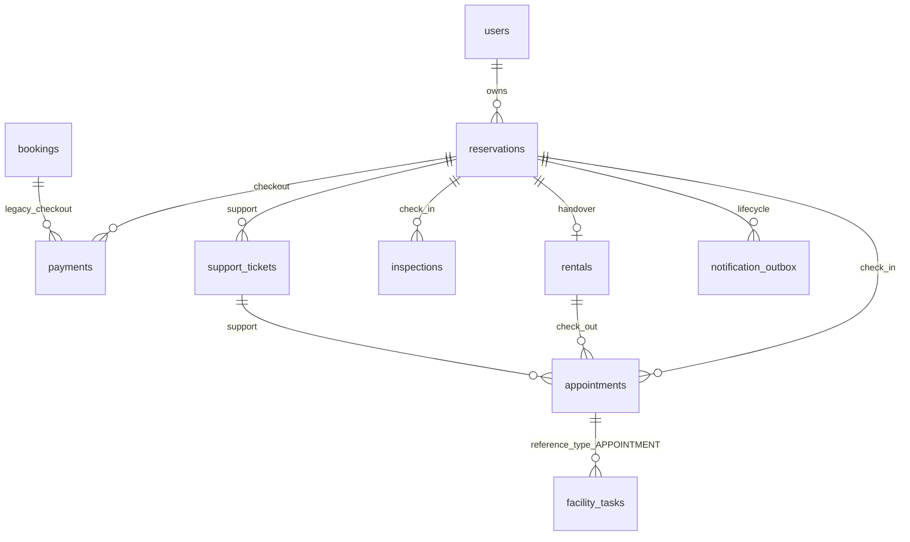
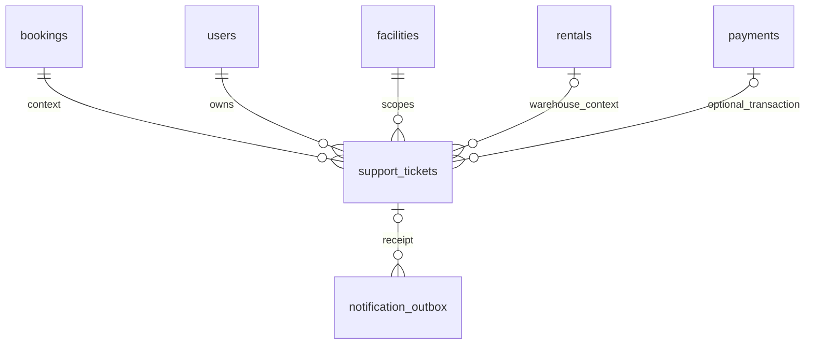

# metastorage database diagram

## Reservation and appointment workflows

`reservations` owns checkout and rental pricing; `appointments` owns meetings,
assignment and receiving. The backend booking module and `/api/bookings` routes
are retired. The `bookings` table remains an archive; new business writes use the
new modules. See [booking cutover](booking-retirement.md) before deployment.
Migration `0013_nostalgic_raza.sql` adds reservation references to support tickets
and notification outbox, each requiring exactly one booking/reservation parent.
After schema commit, the migration runner converts historical records atomically,
keeping IDs, financial facts, rental/inspection history and assigned tasks.

| Table | Main data and rules |
| --- | --- |
| `reservations` | Customer/facility/unit type, requested months, rental period, integer price snapshots and lifecycle. Draft creation checks active offering, schedule, pricing and available capacity. Price snapshots must fit PostgreSQL INTEGER. |
| `appointments` | CHECK_IN references a paid reservation; CHECK_OUT references an active customer rental; SUPPORT references an owned support ticket. Facility/customer scope is derived from that context. Date and slot must be future and within operating hours. One active appointment per context is enforced by service parent locks. The check-in unique index applies to SCHEDULED/CONFIRMED records so cancelled history does not prevent rebooking. One confirmed return per facility/date/slot remains enforced by a partial unique index. |
| `payments` | Exactly one of booking_id or reservation_id is required. The existing provider, idempotency, payment status, provider-event deduplication and manual refund workflow also support reservations. |
| `capacity_allocations` | HOLD reserves capacity for ten minutes during checkout. A successful reservation payment changes it to RESERVATION without expiry. All allocation kinds contribute to the existing capacity calculation. |
| `facility_tasks` | APPOINTMENT owns scheduled work; BOOKING is retained only for archived tasks. CHECK_IN creates CHECK_IN_HANDOVER, CHECK_OUT creates UNIT_INSPECTION and SUPPORT creates HANDLE_SUPPORT. Assignment/reassignment belongs to the appointment workflow. Staff start through the existing task API; completion/cancellation commits with the appointment. |

Payment holds and capacity checks serialize on the same offering rows as legacy
booking checkout. A verified, matching payment confirms a reservation atomically
with its paid allocation. Late payments are accepted only if the offering,
schedule and capacity remain available; otherwise the full amount enters
REFUND_PENDING. Cancellation after payment and no-show refund the rental fee and
forfeit the deposit, matching the approved pre-handover booking policy.
Reservation no-shows are swept at the configured closing hour on the check-in day.
Cancelling a reservation cancels its active appointments and tasks in the same
transaction. Refunds remain manual transfers followed by the existing refund
confirmation endpoint; a webhook does not claim money was already refunded.

Appointment states are SCHEDULED → CONFIRMED → COMPLETED, with CANCELLED/NO_SHOW
terminal alternatives. Manager confirmation requires assigned active staff. Only
the assigned staff can complete a confirmed appointment after starting its task.
Check-in completion additionally requires reservation CHECKED_IN; check-out
completion requires rental CLOSED. Staff start the task, then POST `/api/inspections` with taskId and storageUnitId.
The backend derives the reservation and checks that the physical unit belongs to
its facility/type and has no active assignment, rental or other active check-in
inspection. Unit row locks serialize competing staff selections. Existing
inspection update/checklist/evidence APIs apply. POST `/api/inspections/:id/handover`
with customerReceivedUnit=true requires a PASSED inspection and a confirmed
appointment. One transaction creates the rental, marks the unit OCCUPIED,
marks the reservation CHECKED_IN, releases its capacity allocation and completes
both appointment and task. Replaying handover does not create another rental.
Migration `0012_thin_gateway.sql` adds reservation_id to inspections and rentals;
rentals require exactly one booking/reservation reference, individually unique.
Customer, facility rental reads, payment history and rental reports support both
references; bookingId is nullable and reservationId identifies the new context.
Return inspection, closure and settlement are separate from this receiving flow. SUPPORT completion finishes
the meeting/task without inventing a support-ticket lifecycle.

Routes remain `/api/reservations` and `/api/appointments`. Reservation cancellation
uses PATCH `/:id` with CANCELLED; appointment staff can list `/assigned-to-me`.
Facility list paths are validated and service authorization uses the path facility,
not a frontend-supplied query override. Business writes use transactions and row
locks; no generic deletion endpoints are introduced.

## Rental tối giản (2026-10-28)

Schema code: `packages/database/src/schema/rentals.ts`. Bản xem trước đã được
chuyển thành schema chính. Đã sinh `0008_nostalgic_blacklash.sql` cùng snapshot.
Migration đã đạt kiểm tra trên DB mới và nâng cấp DB tạm có dữ liệu cũ
(xem `docs/rental-reset.md`); chưa áp vào DB ứng dụng, DB hiện hữu chưa đổi cấu trúc.

| Field | Kiểu | Quy tắc |
| --- | --- | --- |
| id | UUID | PK, tự sinh |
| bookingId | UUID | FK bookings.id, UNIQUE, nullable, RESTRICT |
| reservationId | UUID | FK reservations.id, UNIQUE, nullable, RESTRICT; đúng một trong bookingId/reservationId |
| userId | UUID | FK users.id, NOT NULL, RESTRICT; khách thuê |
| storageUnitId | UUID | FK storage_units.id, NOT NULL, RESTRICT |
| status | rental_status | ACTIVE hoặc CLOSED, mặc định ACTIVE |
| startAt | TIMESTAMPTZ | NOT NULL |
| endAt | TIMESTAMPTZ | NOT NULL, lớn hơn startAt |
| createdAt | TIMESTAMPTZ | NOT NULL, mặc định now() |
| updatedAt | TIMESTAMPTZ | NOT NULL, mặc định now(); cập nhật khi ghi |

Tên camelCase ánh xạ snake_case qua cấu hình Drizzle. Index theo userId và
(storageUnitId,status,endAt). Không UNIQUE storageUnitId vì kho có thể được thuê
qua nhiều kỳ khác nhau. userId phải lấy từ chủ booking; service phải kiểm tra ô
kho thuộc đúng cơ sở/loại kho và không trùng thời gian, không nhận chủ thuê tùy ý.

Các chức năng gia hạn, phụ phí/công nợ, điều chỉnh, hoàn tiền rental, lịch trả kho,
quyết toán và nhắc hạn/quá hạn đã được gỡ để xây lại từng phần. Sáu bảng phụ cũ
được bỏ khỏi schema code. Không có bảng thay thế hoặc JSON để giấu cấu trúc cũ.
Thanh toán booking và hoàn tiền do hủy booking vẫn giữ riêng trong payments.
Loại kho giữ giá monthlyPrice tại cơ sở, chưa áp dụng khung giá BOM cũ.

API đọc Customer vẫn ở /api/rentals; API FM thống nhất ở
/api/rentals/facility/:facilityId, kiểm tra phân công cơ sở đang hoạt động.
DTO trả userId, storageUnit, startAt và endAt; dữ liệu hiển thị cơ sở/loại kho
được join từ các quan hệ. Bộ API rental trùng trong facility-workspace đã gỡ.

## System administrator and account lifecycle (#185, approved 2026-10-25)

`users` keeps its existing single role per account. Add partial unique index
users_single_system_admin_idx on role WHERE role = SYSTEM_ADMIN, allowing at most
one bootstrap SA. Management create/role APIs accept only CUSTOMER, FACILITY_STAFF,
FACILITY_MANAGER and BUSINESS_OPERATION_MANAGER. They cannot create/promote SA or
lock/demote the bootstrap SA. If legacy data has multiple SA rows, the unique-index
migration fails atomically for explicit resolution; never delete/disable users to
make it pass. Existing bootstrap/seed is retained.

Account role changes and locking serialize on the users row, then memberships.
Block changes while directly assigned booking is CONFIRMED, manual task is
ASSIGNED/IN_PROGRESS, support ticket is OPEN/IN_PROGRESS, or return
request is PENDING/CONFIRMED/INSPECTING/FAILED. Closed/completed historical work and
created_by/assigned_by audit references do not block changes. The existing handoff
flows remain authoritative; no automatic work transfer is introduced.

After handoff, user change, ending active facility assignments and deletion of all
Better Auth sessions commit together. Reactivation creates neither sessions nor
assignments. Changing assignment keeps sessions but membership guards read current
scope at the next request. SA/BOM keep assignment write permissions. Session
creation holds a user share lock and rechecks ACTIVE inside its insert transaction,
so a simultaneous lock/role change cannot leave a stale session behind.

## User history (#185, confirmed scope 2026-10-25)

`login_history` stores successful sign-ins only, across all roles: UUID id,
nullable user_id FK users (SET NULL), unique session_id (correlation identifier,
never a session token; no FK to transient sessions), occurred_at timestamptz,
nullable bounded device, operating_system, browser and model descriptions.
No failed sign-ins, logout, expiry, IP, credentials, tokens or raw request headers.
Device/model descriptions are best-effort client metadata, not proof of identity.
Indexes: (occurred_at,id), (user_id,occurred_at,id).

`user_activity_logs` records accepted mutation API requests across all roles,
excluding read/list/search/download operations: UUID id, nullable actor_id FK users
(SET NULL), bounded action/entity_type, nullable entity_id when no safe UUID is
available, nullable facility_id FK facilities (SET NULL), occurred_at timestamptz.
Accepted idempotent/no-op writes may appear; this is not an exact state-change ledger.
No arbitrary request payloads or financial/PII
snapshots. Indexes: (occurred_at,id), (actor_id,occurred_at,id),
(entity_type,entity_id,occurred_at,id), (facility_id,occurred_at,id).
Existing domain audits remain authoritative for their detailed before/after facts.

History starts at capture enablement; do not synthesize legacy records. Both logs
are best-effort per the user's 2026-10-25 decision: log failure never fails or rolls
back the main operation and emits an operational warning. SA-only read access
follows #185. Retention/cleanup remain TBD; no automatic cleanup is authorized.
User profile edits allow only own name/phone; administrators cannot edit another
user's profile.

## Facility work tasks

`facility_tasks` is one staff work queue for check-in and handover, unit inspection,
and support handling. `type` is `CHECK_IN_HANDOVER`, `UNIT_INSPECTION`, or
`HANDLE_SUPPORT`; `status` is `ASSIGNED`, `IN_PROGRESS`, `COMPLETED`, or
`CANCELLED`. Each row has UUID id, facility_id, reference_type/reference_id,
assigned_staff_id and assigned_by FKs, nullable description, nullable started_at
and completed_at, assigned_at, created_at and updated_at. The polymorphic reference
types are `BOOKING`, `STORAGE_UNIT`, and `SUPPORT_TICKET`; because one UUID column
cannot have foreign keys to three tables, repositories validate target existence
and same-facility scope under transaction locks.

`CHECK_IN_HANDOVER` references an appointment and is created or reassigned in the
same transaction as manager appointment assignment. `UNIT_INSPECTION` references an
appointment or storage unit; `HANDLE_SUPPORT` references a support ticket. Reassignment
resets an in-progress task to `ASSIGNED`; same assignee retries are no-ops. The
assigned active Facility Staff starts and completes the task. An assigned-facility
FM may cancel unfinished work. There is no separate task report, approval state,
title, or completion actor field; the existing inspection and support records own
their domain details.

Facility staff membership cannot be revoked while an assigned task is
`ASSIGNED` or `IN_PROGRESS`; booking and return workflows retain their own
assignment constraints.

## Existing constraints and behavior

- Booking confirmation emails have an intent/snapshot in the existing durable outbox,
  inserted in the payment transaction. The worker prepares an authenticated account
  booking URL and encrypted payload, then bridges to the existing BullMQ job/delivery ID.
  Legacy jobs remain readable; ENQUEUED differs from provider-confirmed SENT.

- UUID primary keys on `users`, `facilities`, `facility_assignments`,
  `facility_tasks`,
  `unit_types`, `storage_units`, `check_in_slots`,
  and `capacity_allocations` default to generated random UUIDs. Auth tables
  `accounts`, `sessions` and `verifications` use text primary keys.
- `users.email`, `users.phone`, `facilities.code`, `storage_units.code` and
  `sessions.token` are unique. `users.phone` is nullable. Booking contact email is not unique.
- Varchar limits are `users.email` 255, `users.phone` 20, Booking contact phone 32,
  `facilities.code` 50 and `facilities.name` 150;
  `unit_types.code` 80, `unit_types.name` 100, `unit_types.size_label` 50;
  `storage_units.code` 80.
- Nullable columns are `users.image`, `users.phone`,
  `users.role`, `users.status`, `facilities.description`,
  `facility_assignments.ended_at`, `storage_units.floor`,
  `storage_units.location_description`,
  `facility_tasks.started_at`, `facility_tasks.completed_at`,
  payment provider checkout fields, `paid_at`, `expires_at`, and booking refund metadata;
  All nine rental columns are NOT NULL;
  `sessions.ip_address`,
  `sessions.user_agent`, and the optional token, expiry, scope and password
  fields in `accounts`. Other nullability follows the Drizzle schema.
- User role/status values are defined once in `packages/contracts/src/users.ts` and
  reused by Drizzle and API contracts. Changing those values still requires a database migration.
- Enum values are `role`: `CUSTOMER`, `FACILITY_STAFF`, `FACILITY_MANAGER`,
  `BUSINESS_OPERATION_MANAGER`, `SYSTEM_ADMIN`; `status`: `ACTIVE`, `INACTIVE`;
  `storage_unit_status`: `AVAILABLE`, `RESERVED`, `OCCUPIED`, `MAINTENANCE`,
  `INSPECTION`, `RETURN_PENDING`, `LOCKED`, `INACTIVE`;
  `facility_task_type`: `CHECK_IN_HANDOVER`, `UNIT_INSPECTION`, `HANDLE_SUPPORT`;
  `facility_task_status`: `ASSIGNED`, `IN_PROGRESS`, `COMPLETED`, `CANCELLED`;
  `facility_task_reference_type`: `BOOKING`, `STORAGE_UNIT`, `SUPPORT_TICKET`;
  `capacity_allocation_kind`: `HOLD`, `BOOKING`; and
  `capacity_allocation_status`: `ACTIVE`, `RELEASED`, `EXPIRED`;
  `inspection_type`: `CHECK_IN`, `CHECK_OUT`, `MAINTENANCE`;
  `inspection_status`: `PENDING`, `IN_PROGRESS`, `PASSED`, `FAILED`;
  `inspection_condition`: `GOOD`, `MINOR_DAMAGE`, `MAJOR_DAMAGE`;
  `cloudinary_resource_type`: `image`, `video`, `raw`;
  `payment_status`: `PENDING`, `SUCCEEDED`, `FAILED`, `REFUND_PENDING`, `REFUNDED`;
  `payment_refund_reason_code`: `NO_CAPACITY`, `CHECK_IN_CLOSED`,
  `OFFERING_UNAVAILABLE`, `CUSTOMER_CANCELLATION`, `NO_SHOW`;
  `rental_status`: `ACTIVE`, `CLOSED`.
- Composite unique `accounts(provider_id, account_id)` ensures one owner per provider
  identity, including concurrent OAuth linking. Existing duplicates must be resolved
  explicitly before applying this constraint; never merge users automatically.
- Composite unique indexes exist on `facility_assignments(user_id, facility_id)`.
- Each User may work at at most one Facility at a time. A partial unique index
  `facility_assignments_active_user_idx` on `user_id WHERE is_active = true`
  enforces this rule, including concurrent assignments. Inactive assignments are
  retained. End or revoke the current assignment before assigning another Facility;
  elapsed `ended_at` rows must be deactivated before reassigning. The API does not
  automatically revoke a still-effective assignment to another Facility.
- Login through the shared API client and `GET /api/auth/me` include
  `user.assignedFacilityId`: the current assignment's Facility ID or `null`.
  Only assignments matching the User's Facility Staff/Manager role, with
  `is_active = true` and no elapsed `ended_at`, qualify. This field is derived,
  not a new column on User or Session, and does not replace backend scope checks.
- Before applying the single-Facility index migration, check for Users with
  multiple `is_active = true` assignments. Resolve them explicitly before
  migrating; the migration must not choose a Facility or discard history.
- `unit_types.code` is unique within a facility; `(facility_id,id)` is unique.
- `storage_units`, `bookings` and `capacity_allocations`
  each use a composite foreign key `(facility_id,unit_type_id)` to
  `unit_types(facility_id,id)` with ON DELETE RESTRICT. Range and facility ownership
  references also use RESTRICT. `capacity_allocations.reference_id` remains a UUID
  reference value without a database foreign key.
- User foreign keys use `ON DELETE CASCADE` for `accounts`, `sessions` and
  `facility_assignments`, and `ON DELETE RESTRICT` for `bookings.user_id`.
  Facility task references use `ON DELETE RESTRICT` to preserve assigned work.
  Facility foreign keys use `ON DELETE CASCADE` for
  `storage_units` and `facility_assignments`, and
  `ON DELETE RESTRICT` for capacity allocations.
- `created_at` and `updated_at` columns default to `now()` wherever shown;
  `assigned_at` also defaults to `now()`. `facilities.is_active`,
  `unit_types.is_active` and
  `facility_assignments.is_active` default to true.
  `storage_units.status` defaults to `AVAILABLE`,
  `capacity_allocations.status` to `ACTIVE`. The default operating timezone is
  `Asia/Ho_Chi_Minh`. Operating hours are now global system settings, not a table.

Unit types belong to a facility and own their dimensions and monthly price within a
BOM-managed rental price range. Exact length, width and height are positive meters;
`size_cbm` is generated as their product, and floor area is calculated when reading.
Physical units inherit the dimensions of their local type. Availability and capacity
are scoped to `(facility_id,unit_type_id)`. Public catalog requires an active facility,
active type and active configured range containing its price.
Customers select a type; operations assign the physical unit later.

## Sơ đồ quan hệ hiện tại trong code

```mermaid
erDiagram
  facility_tasks {
    uuid id PK
    uuid facility_id FK
    facility_task_type type
    facility_task_status status
    facility_task_reference_type reference_type
    uuid reference_id
    uuid assigned_staff_id FK
    uuid assigned_by FK
    integer version
    timestamptz started_at "nullable"
    timestamptz completed_at "nullable"
    timestamptz assigned_at
    timestamptz created_at
    timestamptz updated_at
  }
  facilities ||--o{ facility_tasks : scopes
  users ||--o{ facility_tasks : performs
  users ||--o{ facility_tasks : assigns
  facility_tasks }o--|| bookings : "reference when BOOKING"
  facility_tasks }o--|| storage_units : "reference when STORAGE_UNIT"
  facility_tasks }o--|| support_tickets : "reference when SUPPORT_TICKET"
  system_settings {
    text key PK
    jsonb value
    text description
    integer version
    uuid updated_by FK
    timestamptz updated_at
  }
  system_setting_changes {
    uuid id PK
    text key FK
    jsonb before
    jsonb after
    uuid actor_id FK
    text source
    timestamptz created_at
  }
  system_settings ||--o{ system_setting_changes : audits
  users ||--o{ system_setting_changes : changes
  pricing_changes {
    uuid id PK
    integer version UK
    pricing_change_operation operation
    jsonb before
    jsonb after
    uuid changed_by FK
    timestamptz changed_at
  }
  users o|--o{ system_settings : updates
  users ||--o{ pricing_changes : changes
  inspections {
    uuid id PK
    uuid storage_unit_id FK
    uuid rental_id FK "nullable"
    uuid booking_id FK "nullable"
    uuid inspected_by FK
    uuid task_id FK
    inspection_type inspection_type
    inspection_status status
    inspection_condition condition "nullable"
    jsonb checklist
    text notes "nullable"
    timestamptz inspected_at "nullable"
    timestamptz inspect_done_at "nullable"
  }
  media_assets {
    uuid id PK
    varchar owner_type
    uuid owner_id
    varchar purpose
    uuid uploaded_by FK
    varchar filename
    varchar mime_type
    integer byte_size
    cloudinary_resource_type cloudinary_resource_type
    text cloudinary_public_id
    varchar cloudinary_format
    timestamptz created_at
  }
  check_in_slots ||--o{ bookings : schedules
  users ||--o{ accounts : authenticates_with
  users ||--o{ sessions : signs_in_with
  users ||--o{ facility_assignments : receives
  facilities ||--o{ facility_assignments : has
  facilities ||--o{ unit_types : owns
  unit_types ||--o{ storage_units : materializes
  unit_types ||--o{ capacity_allocations : allocates
  unit_types ||--o{ bookings : books
  unit_types ||--o{ storage_units : materializes
  facilities ||--o{ storage_units : contains
  unit_types ||--o{ capacity_allocations : allocates
  facilities ||--o{ capacity_allocations : reserves
  users o|--o{ bookings : saves_history
  users o|--o{ bookings : assigned_to
  bookings ||--o| rentals : becomes
  users ||--o{ rentals : rents
  storage_units ||--o{ rentals : occupies
  bookings ||--o{ payments : records
  users o|--o{ payments : confirms_manual_refund
  bookings o|--o{ inspections : checkin_context
  rentals o|--o{ inspections : checkout_context
  storage_units ||--o{ inspections : inspected
  facility_tasks ||--o{ inspections : assigned_work
  users ||--o{ inspections : inspects
  users ||--o{ media_assets : uploads

  check_in_slots {
    uuid id PK
    text name
    time start_time
    time end_time
  }

  users {
    uuid id PK
    text name
    varchar email UK
    boolean email_verified
    text image
    varchar phone UK
    role role
    status status
    timestamptz created_at
    timestamptz updated_at
  }

  accounts {
    text id PK
    uuid user_id FK
    text account_id
    text provider_id
    text access_token
    text refresh_token
    text id_token
    timestamptz access_token_expires_at
    timestamptz refresh_token_expires_at
    text scope
    text password
    timestamptz created_at
    timestamptz updated_at
  }

  sessions {
    text id PK
    uuid user_id FK
    text token UK
    timestamptz expires_at
    text ip_address
    text user_agent
    timestamptz created_at
    timestamptz updated_at
  }

  verifications {
    text id PK
    text identifier
    text value
    timestamptz expires_at
    timestamptz created_at
    timestamptz updated_at
  }

  facility_assignments {
    uuid id PK
    uuid user_id FK
    uuid facility_id FK
    timestamptz assigned_at
    timestamptz ended_at
    boolean is_active
    role role
  }

  facilities {
    uuid id PK
    varchar code UK
    varchar name
    text address
    text description
    boolean is_active
    timestamptz created_at
    timestamptz updated_at
  }


  unit_types {
    uuid id PK
    uuid facility_id FK
    varchar code "unique within facility"
    varchar name
    varchar size_label
    numeric length_m
    numeric width_m
    numeric height_m
    numeric size_cbm "generated"
    integer monthly_price
    boolean is_active
    integer version
    uuid updated_by FK "nullable"
    timestamptz created_at
    timestamptz updated_at
  }

  storage_units {
    uuid id PK
    uuid facility_id FK
    uuid unit_type_id FK
    varchar code UK
    varchar floor "nullable"
    varchar location_description "nullable"
    storage_unit_status status
    timestamptz created_at
    timestamptz updated_at
  }

  capacity_allocations {
    uuid id PK
    uuid facility_id FK
    uuid unit_type_id FK
    uuid reference_id
    capacity_allocation_kind kind
    capacity_allocation_status status
    timestamptz starts_at
    timestamptz ends_at
    timestamptz created_at
    timestamptz updated_at
  }

  bookings {
    uuid id PK
    varchar booking_code UK
    uuid user_id FK "required; ON DELETE RESTRICT"
    varchar contact_phone "nullable before payment; booking-specific"
    uuid facility_id FK
    uuid unit_type_id FK
    integer requested_months
    date check_in_date
    uuid check_in_slot_id FK
    timestamptz rental_end_at
    numeric monthly_rate_snapshot
    numeric rental_fee_amount
    numeric deposit_amount
    numeric total_amount
    varchar status "default DRAFT"
    uuid assigned_staff_id FK "nullable"
    varchar qr_token_hash UK
    timestamptz created_at
    timestamptz updated_at
  }

  rentals {
    uuid id PK
    uuid booking_id FK,UK
    uuid user_id FK
    uuid storage_unit_id FK
    rental_status status
    timestamptz start_at
    timestamptz end_at
    timestamptz created_at
    timestamptz updated_at
  }






  payments {
    uuid id PK
    uuid booking_id FK "nullable for rental-charge payments"
    uuid rental_id FK "nullable return refund"
    varchar provider "nullable for manual refund"
    varchar provider_payment_id "nullable"
    varchar payment_code UK "nullable"
    varchar hold_token_hash "nullable for charge payment"
    varchar idempotency_key UK
    numeric total_amount
    varchar currency
    payment_status status
    timestamptz paid_at
    timestamptz expires_at "nullable payment quote expiry"
    payment_refund_reason_code refund_reason "nullable"
    numeric refund_amount "nullable; legacy refund falls back to total_amount"
    numeric deposit_forfeited_amount "NOT NULL DEFAULT 0"
    varchar refund_reference "nullable; bank transfer reference/evidence"
    timestamptz refunded_at "nullable"
    uuid refunded_by FK "nullable; ON DELETE RESTRICT"
    timestamptz created_at
    timestamptz updated_at
  }

  payment_provider_events {
    uuid id PK
    varchar provider
    varchar provider_event_id
    uuid payment_id FK
    varchar payment_code
    numeric amount
    varchar transfer_type
    varchar reference_code
    payment_provider_event_status status
    jsonb payload_metadata
    timestamptz created_at
    timestamptz updated_at
  }

  unit_assignments {
    uuid id PK
    uuid booking_id FK
    uuid physical_unit_id FK
    uuid assigned_by FK
    varchar status
    timestamptz assigned_at
    timestamptz ended_at
    text reason
  }

```

## Historical booking design (superseded by reservation cutover)

The following booking-specific notes describe archived records and retired routes.
Current receiving behavior is defined at the top of this document.

### Account-required booking (approved 2026-10-25; supersedes guest decisions)

Only active authenticated CUSTOMER accounts can create booking drafts, start payments,
read payment status, cancel bookings, or access their rentals/documents and return details.
Ownership is bookings.user_id, required with ON DELETE RESTRICT. No email-based claim,
guest checkout token, magic link, guest cookie or guest actor grants business access.
Existing guest business records are deleted before imposing NOT NULL; account-owned
records remain. Name and email are read from users, not copied onto bookings.
Signup does not require phone. At payment, contactPhone can be supplied for this booking;
otherwise users.phone is used. A valid phone is required, stored on bookings only, and
never written back to users. ContactPhone may be NULL only while the booking is DRAFT.
Issued contracts retain their own immutable snapshots. Payments and rentals continue to
derive ownership through booking. Accounts with bookings cannot be physically deleted;
use the existing account lock/status workflow instead. Guest access endpoints are removed.
The legacy reservation-draft checkout and table are removed.

## Payment and Booking notes (#18)

- Booking drafts store immutable pricing columns: rental fee equals
  the monthly rate times the requested months; the deposit equals one month's
  rate; total equals rental fee plus deposit, in VND. Payments use this stored
  quote even if catalog prices change later. Legacy unpriced drafts must be recreated.

- Booking stores per-booking phone and pricing snapshots; name/email come from users.
- bookings.user_id is required, indexed and references users with ON DELETE RESTRICT.
  Payment and Rental have no customer_id columns.
- paidAt comes from the earliest non-null payments.paid_at with status SUCCEEDED,
  REFUND_PENDING or REFUNDED. Booking queries join slots and aggregate payments before joining,
  preventing duplicate booking rows. Other consumers retain their timestamp
  projection until their dedicated query refactors.
- Booking status defaults to DRAFT; a CHECK limits it to DRAFT, CONFIRMED,
  CANCELLED, NO_SHOW or CHECKED_IN. Pricing columns remain required.
- Bookings retain nullable unique booking_code/qr_token_hash, nullable
  assigned_staff_id and required user_id. Operational lists/details
  exclude DRAFT; drafts cannot be assigned a unit/staff or verified through QR.
- Payment stores the transaction total, currency, provider references, status
  and paid_at; the monthly rate, rental fee and deposit breakdown belong to
  Booking. Readers project booking contact and date/slot timestamps for the
  existing API contracts.
- Payment status values are PENDING, SUCCEEDED, FAILED, REFUND_PENDING and REFUNDED,
  defined in the payment contract and reused by Drizzle. A valid incoming payment
  that cannot receive capacity/check-in becomes REFUND_PENDING with paid_at and
  refund_reason, while its booking stays DRAFT and holds are released. The full
  payment total (rent plus deposit) must be refunded manually. Only an admin or
  business operations manager may record REFUND_PENDING -> REFUNDED with a
  nonblank transfer reference, server timestamp and actor. Replays with the same
  reference preserve the original audit; a different reference conflicts.
- Customer cancellation and NO_SHOW retain the original payment total and snapshot
  `refund_amount = bookings.rental_fee_amount` and
  `deposit_forfeited_amount = bookings.deposit_amount`. Refund reasons distinguish
  CUSTOMER_CANCELLATION and NO_SHOW from full refunds for unfulfillable checkout.
  Refund amounts and forfeitures must be nonnegative, cannot individually exceed
  total_amount, and their sum cannot exceed total_amount. Existing pending/refunded
  rows with NULL refund_amount retain the previous full-total refund behavior.
  Manual refund readers/confirmation use the snapshotted refund amount.
- Payment provider integration is selected through a gateway adapter. The
  current implementation provides a mock/test adapter; the production provider
  pricing policy uses the confirmed one-month deposit rule for checkout.
- A successful payment changes the matching active capacity allocation from
  `HOLD` to `BOOKING` inside the same transaction. No physical unit is assigned
  at checkout.
- `payments.idempotency_key` and `(provider, provider_payment_id)` are unique.
- Payments now reference their booking directly. Rental-charge and return-transfer
  references are retired. Booking payment idempotency, provider transaction uniqueness
  and cancellation refund metadata remain.

Check-in slots are shared time-of-day definitions with exactly four required
columns: `id`, `name`, `start_time`, `end_time`. A Booking stores a required
`check_in_date` and `check_in_slot_id` instead of start/end timestamps. The
calendar date is interpreted in the facility timezone (currently Vietnam time).
Referenced slots cannot be deleted (`ON DELETE RESTRICT`). This change is
represented in the database by date and slot. Booking, payment, check-in and
rental readers project the start/end timestamps into existing API DTOs in
Asia/Ho_Chi_Minh time. Legacy draft requests map check_in_at to the containing
slot (start inclusive, end exclusive) and normalize draft/hold dates to that
slot's start before charging. A request outside the slots is rejected. Previously
created drafts with an unnormalized schedule must be recreated before payment.

ACTIVE rentals block unit reassignment. The old return-closure workflow is retired.

## Unified system settings (2026-10-20; supersedes global settings tables above)

`system_settings` is the single active global configuration table: key PK, scalar JSONB
value, description, nonnegative version, updated_by FK users and updated_at. API keys
are an allowlist with per-key validation and permissions. Initial keys are
EXPIRY_REMINDER_DAYS (7), ABANDONED_REVIEW_DAYS (7), OVERDUE_FEE_RATE (25),
DEPOSIT_MONTHS (1), OPENING_HOUR (8) and CLOSING_HOUR (20). Day/hour settings use
bounded integers, rate 0–100 and months positive. DEPOSIT_MONTHS retains the positive shared pricing revision: price changes
also lock/increment this row. Existing quote/rental/settlement snapshots are unchanged.
System Admin manages rental-day settings; BOM manages financial settings and shared
operating hours. Return checklist versions, unit type prices and financial snapshots
remain relational domain data. Holiday calendars are out of scope.

`system_setting_changes`: UUID id, key FK, JSONB before/after value+version snapshots,
actor_id FK, source and created_at. Append-only changes share the update transaction;
existing pricing_changes remain the pricing history source.

The pre-production baseline creates the current settings schema directly. Existing
development databases must be reset before applying it; no legacy configuration
transfer is included.

## Customer Support request model (2026-10-27)

Support is a one-way customer request. Customers can discover their booking and
payment context, submit a subject and description, then view the immutable ticket.
There is no support chat, image upload, staff assignment, or ticket lifecycle.

### support_tickets

| Columns | Type and constraints |
| --- | --- |
| id | UUID primary key, server generated |
| booking_id, owner_user_id, facility_id | Required UUID foreign keys derived from the authenticated booking |
| rental_id | Nullable UUID FK; required for warehouse categories and must belong to the booking |
| payment_id | Nullable UUID FK; if present must belong to the booking |
| category | UNIT, LOCK, ACCESS_CODE, STORED_ITEMS, or PAYMENT |
| subject | Trimmed varchar(200), required |
| description | Trimmed text, 1–5000 characters |
| action_due_at | Required timestamp, created_at + 12 continuous hours |
| idempotency_key | Required key, unique with owner_user_id; request fields are compared on retry |
| created_at | Server-generated timestamp |

The initial request is the ticket itself. `notification_outbox` records the
creation receipt in the same transaction. Removed tables: `support_messages`,
`support_attachments`, `support_audit`, and `support_idempotency`.
Recheck current ownership/facility/assignee at read or sensitive delivery time.
Revoked FS can receive only a minimal revocation notice, without old ticket data.

### Lifecycle, workload and 12-hour tracking

Ticket lifecycle: OPEN → IN_PROGRESS → CLOSED. Assignment immediately enters
IN_PROGRESS; a separate FS start records first_onsite_started_at without another
ticket transition. FS report remains IN_PROGRESS until FM accepts/closes for
warehouse categories. BOM starts/resolves PAYMENT under its role.
Customer withdrawal closes with CUSTOMER_WITHDREW, stops Support work and never
marks an unfinished report/task successfully completed. Reopen is FM/BOM only
within category scope and requires a fresh assignment where needed.

12 continuous hours starts at created_at, without resetting on reassign.
Warehouse measurement distinguishes “FS assigned” and “FS arrived/started”;
assignment alone does not prove an onsite response. PAYMENT measures BOM's first
contact/start in 12 hours. Reopen preserves original timing/audit and does not
invent a fresh automatic SLA cycle or change the ticket's original created_at.
Priority HIGH is processed ahead of NORMAL; both retain the 12-hour maximum.
No new auto-dispatch, SLA engine, automatic escalation or realtime is approved.
There is no cross-role ESCALATE action in MVP; overdue work stays with the
authorized FM/BOM category owner and is visible in its manual queue.

Support ticket text remains on support_tickets; staff assignment is a linked
HANDLE_SUPPORT facility task. The task does not replace ticket content or alter
booking, inspection, occupancy, rental, payment, maintenance or access-code state.

## Facility workspace support events

The existing notification_outbox lifecycle enum additionally supports SUPPORT_UPDATED.
Support operation events use the existing support_ticket_id, versioned event key and
recipient uniqueness; IN_APP records are stored as SENT and are never mailed. Public
replies/resolutions enqueue customer email; private notes never enter customer or FS
notifications. Staff inbox visibility rechecks current ticket assignment and active
facility membership. No new ticket/message table is introduced.
