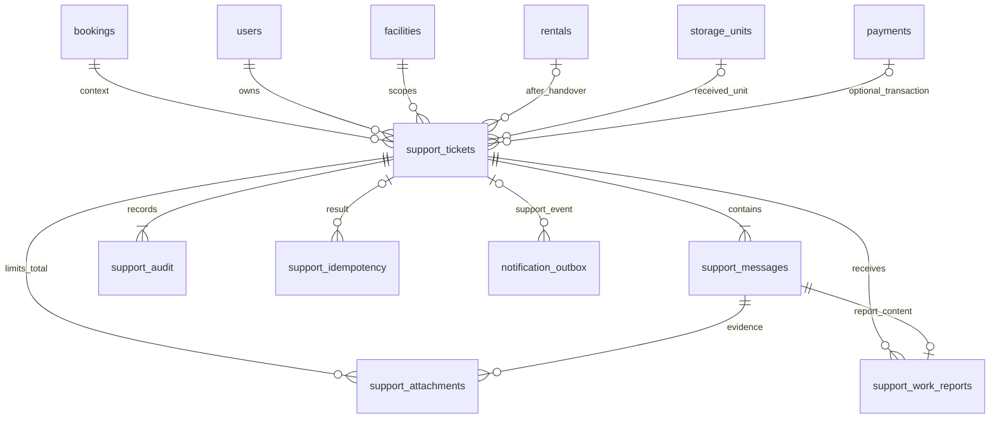

# metastorage database diagram

## System administrator and account lifecycle (#185, approved 2026-10-25)

`users` keeps its existing single role per account. Add partial unique index
users_single_system_admin_idx on role WHERE role = SYSTEM_ADMIN, allowing at most
one bootstrap SA. Management create/role APIs accept only CUSTOMER, FACILITY_STAFF,
FACILITY_MANAGER and BUSINESS_OPERATION_MANAGER. They cannot create/promote SA or
lock/demote the bootstrap SA. If legacy data has multiple SA rows, the unique-index
migration fails atomically for explicit resolution; never delete/disable users to
make it pass. Existing bootstrap/seed is retained.

Account role changes and locking serialize on the users row, then memberships.
Block changes while directly assigned booking is CONFIRMED, manual task is
ASSIGNED/IN_PROGRESS/AWAITING_APPROVAL, support ticket is OPEN/IN_PROGRESS, or return
request is PENDING/CONFIRMED/INSPECTING/FAILED. Closed/completed historical work and
created_by/assigned_by audit references do not block changes. The existing handoff
flows remain authoritative; no automatic work transfer is introduced.

After handoff, user change, ending active facility assignments and deletion of all
Better Auth sessions commit together. Reactivation creates neither sessions nor
assignments. Changing assignment keeps sessions but membership guards read current
scope at the next request. SA/BOM keep assignment write permissions. Session
creation holds a user share lock and rechecks ACTIVE inside its insert transaction,
so a simultaneous lock/role change cannot leave a stale session behind.

## User history (#185, confirmed scope 2026-10-25)

`login_history` stores successful sign-ins only, across all roles: UUID id,
nullable user_id FK users (SET NULL), unique session_id (correlation identifier,
never a session token; no FK to transient sessions), occurred_at timestamptz,
nullable bounded device, operating_system, browser and model descriptions.
No failed sign-ins, logout, expiry, IP, credentials, tokens or raw request headers.
Device/model descriptions are best-effort client metadata, not proof of identity.
Indexes: (occurred_at,id), (user_id,occurred_at,id).

`user_activity_logs` records accepted mutation API requests across all roles,
excluding read/list/search/download operations: UUID id, nullable actor_id FK users
(SET NULL), bounded action/entity_type, nullable entity_id when no safe UUID is
available, nullable facility_id FK facilities (SET NULL), occurred_at timestamptz.
Accepted idempotent/no-op writes may appear; this is not an exact state-change ledger.
No arbitrary request payloads or financial/PII
snapshots. Indexes: (occurred_at,id), (actor_id,occurred_at,id),
(entity_type,entity_id,occurred_at,id), (facility_id,occurred_at,id).
Existing domain audits remain authoritative for their detailed before/after facts.

History starts at capture enablement; do not synthesize legacy records. Both logs
are best-effort per the user's 2026-10-25 decision: log failure never fails or rolls
back the main operation and emits an operational warning. SA-only read access
follows #185. Retention/cleanup remain TBD; no automatic cleanup is authorized.
User profile edits allow only own name/phone; administrators cannot edit another
user's profile.

## Facility-owned catalog and BOM ranges (approved 2026-10-24)

`rental_price_ranges`: UUID id, unique code, name, nullable integer-VND
min_monthly_price/max_monthly_price (both null for unconfigured/migrated ranges, or
0 < min <= max), is_active, nonnegative version, nullable updated_by FK users
(RESTRICT), created_at/updated_at. BOM alone creates/updates ranges. A range update
must reject any linked local price outside the proposed bounds; no guessed defaults.

`unit_types` belongs to exactly one facility through required facility_id FK
(RESTRICT) and one required price_range_id FK (RESTRICT). Code is unique per facility;
(facility_id,id) is also unique for composite references. Existing name/size_label,
positive dimensions, generated size_cbm, positive integer monthly_price and is_active remain local.
Add nonnegative version (default 0) and nullable updated_by FK users (RESTRICT).
Only the currently assigned active FM writes local types/prices. Dimension edits
are rejected once any booking or reservation draft references the type; create a
new type and move eligible free physical units instead. Price changes affect only
new quotes; booking/renewal/PDF snapshots are immutable. There is no unit_type_changes.
FM price writes and BOM range writes append the existing pricing_changes ledger;
the shared pricing revision remains serialized by the DEPOSIT_MONTHS settings row.

`facility_unit_types` is retired. storage_units/bookings/reservation_drafts/
capacity_allocations reference unit_types through (facility_id,unit_type_id),
preventing cross-facility types. Catalog, checkout and renewal lock the local type
in place of the retired offering. Range validation uses range-first/type-second
locks after the shared pricing revision; new quotes require configured active
bounds. Captures of existing quotes retain saved prices rather than recalculating.

Migration expands the schema, transfers every existing facility/type pair into a
local type (retaining the original UUID for the first facility and cloning others),
remaps the four composite references, then enforces NOT NULL/FKs and retires the
join table. Unassigned or nonpositive-priced legacy types fail preflight for explicit
resolution rather than silently losing data. Existing scalar settings, payment
amounts, audit JSON and contract/renewal snapshots are not rewritten. The migration
runner performs the transfer within its existing atomic migration transaction.

## Rental renewals (#163, approved 2026-10-24)

`rental_renewals` retains immutable quote/acceptance facts: UUID id, rental_id FK,
nullable customer_id FK (SET NULL on account deletion), rental_version, unique
nullable charge_id/payment_id FKs, per-rental idempotency_key, status
(QUOTED/AWAITING_PAYMENT/APPLIED/EXPIRED/REFUND_REQUIRED), months 1..12,
old_end_at/new_end_at, positive integer-VND monthly_rate/amount, VND currency,
timezone/cutoff_at/expires_at, terms_version/terms, accepted_at/applied_at,
failure_reason and created_at. Amount equals months × snapshotted rate; each month
adds exactly 720 hours; expiry is at most 15 minutes after creation and no later
than the saved local cutoff. Acceptance creates one OPEN RENEWAL/RENEWAL_RENT
charge. Applied terms require an identified payment and application timestamp.
Partial unique (rental_id,rental_version) for APPLIED prevents duplicate extension.

`rentals.version` is nonnegative, starts at zero and increases once per applied
renewal. `expected_end_at` remains the current term; original booking end/pricing
and issued PDFs are unchanged. `notification_outbox.rental_term_version` is nullable
for legacy events; expiry/overdue/review events identify the current term, and the
worker suppresses a queued event for an older version (legacy means version zero).
Facility → booking → rental locks serialize renewal with return/lifecycle;
the existing facility/type offering lock serializes capacity with checkout.
Quotes hold no capacity. Expired/conflicting captures create source-linked refunds
instead of extending or moving the physical unit. Unpaid RETURN_DEBT anywhere on
the customer's rentals blocks renewal; EXTRA is a separate obligation.
No unused rent refund for early return, including initial and renewal terms.
Historical refunds/snapshots remain recorded; captured but unapplied renewal money
uses the controlled charge-refund workflow.
OVERDUE begins at the saved expiry instant for an unreturned rental. Return-fee
assessment still compares local calendar dates; abandoned review keeps the existing
seven-full-local-day boundary starting at midnight on the following date.

## Flow 5 manual task assignment

`facility_tasks` stores manual work assigned by the active Facility Manager to an
active Facility Staff account at the same facility. Types are `INSPECT_UNIT`,
`PRINT_DOCUMENT` and `REPORT_TO_MANAGER`. Columns: UUID id, facility_id,
assigned_staff_id, created_by and assigned_by FKs, type, title (1..200 trimmed
characters), nullable description (up to 2000 characters), nullable storage_unit_id
and booking_id FKs, nonnegative integer version (default 0), lifecycle status,
nullable started_at, completed_by and completed_at, assigned_at, created_at and
updated_at. All foreign keys use RESTRICT to preserve assignments. Indexes cover
(facility_id, assigned_staff_id) and (facility_id, type).

Creation and reassignment validate current account roles, ACTIVE status and active,
unexpired facility assignments under row locks. Optional unit/booking references
must belong to the task facility. Reassignment uses the expected version; assigning
the same current staff member at the current version is a no-op. Lifecycle is
ASSIGNED → IN_PROGRESS → AWAITING_APPROVAL → COMPLETED. Only FM acceptance of the
latest report completes a task; the report stores the accepting FM and time. Task
metadata does not change booking assignees, inspection permissions, physical
occupancy, contracts, rentals or maintenance. Existing Flow 2/contract APIs remain
authoritative for execution; creating a printing task does not assert that a
document has actually been printed.

Facility staff membership cannot be revoked while bookings or tasks remain
assigned; those items must be reassigned first.

## Flow 5 staff work reports (confirmed 2026-10-22)

`facility_task_reports`: UUID id, task_id FK facility_tasks (RESTRICT),
submitted_by FK users (RESTRICT), nullable accepted_by FK users and accepted_at,
content text (trimmed, 1..5000 characters), submitted_at timestamptz default now.
Index (task_id, submitted_at, id) supports ordered history; a partial unique index
allows at most one accepted report per task. One task has many immutable
submissions; each submission keeps its original author even after reassignment.
No edit/delete report API.

Only the current active assigned FS with a valid same-facility assignment may
submit. Same-facility FM and current assigned FS may read task report history.
Submission rechecks authorization under task/account/membership row locks in the
same order as task reassignment. Identity/time are server-generated. Reporting
does not itself complete a task or mutate booking/unit/rental/inspection state.
The assigned-facility FM accepts the latest report to complete the task.

## Flow 5 physical-unit maintenance history

`storage_unit_maintenance_history` records each allowed maintenance transition:
UUID id, storage_unit_id FK, action (`ENTER_MAINTENANCE` or `EXIT_MAINTENANCE`),
previous/next storage-unit status, optional reason, changed_by FK users, and
changed_at. A status update and its history record commit in the same transaction.
The actor and reason are retained for audit; history prevents hard deletion of the
physical unit and the acting account.

## Booking contract PDFs (confirmed 2026-10-20)

MVP customer identity uses account name/email and booking-specific contactPhone;
no CCCD/passport columns or identity-document storage are introduced.
`booking_contracts`: UUID id, booking_id FK, immutable positive version (unique per
booking), UPLOADED/ISSUED status, filename, byte_size (1..20MiB), positive page_count,
SHA256, private unique object_key, idempotency_key unique per booking, uploaded_by/at,
issued_by/at nullable until issuance, JSONB terms_snapshot nullable until issuance.
The latest ISSUED version is current; uploading alone never replaces the issued
version or creates a signature. No revoke, signing, renewal or transfer workflow.
`booking_contract_audit`: UUID id, booking_id/contract_id/actor_id FKs, action,
JSONB details, occurred_at. Immutable upload/issuance/handover audit.
`handover_inspections.contract_id`: nullable FK booking_contracts; existing handovers
remain null, new handovers require an issued valid linked PDF and save its exact
version. Booking → Rental remains the authoritative contract linkage after handover.
Issue snapshots existing customer/facility/unit-type/pricing/deposit/term and verified
successful payment. Issuance and new handover share booking-first row locks; a stale
current-issued expectation conflicts. No uploads/issues after physical handover.
Private authenticated Cloudinary raw PDFs use unique immutable object keys as public IDs;
no public storage URLs in DTOs. Backend
checks role, ownership/facility scope and linkage before reading bytes. Failed DB
writes clean up only their new object; preserved versions are never deleted by API.

## Return workflow (confirmed 2026-10-20)

This additive feature is independent of handover inspections/check-in checklist.
`return_checklist_versions`: UUID id, unique integer version, JSONB items
(code/label/group/serious), created_by FK users and created_at. Versions are immutable;
Admin appends a version with optimistic concurrency. There is no inferred initial
checklist; all four confirmed groups must be configured before starting inspection.

`facility_return_calendars`: facility_id PK/FK, timezone, JSONB holiday dates,
reminder_time (09:00 default), version, updated_by FK users and updated_at. Admin
configures it; operating hours and check_in_slots remain existing sources. Slots
are 90 minutes, capacity one and a 15-minute cooldown; schedule changes flag
confirmed appointments for manual review while preserving time snapshots.

`system_settings` key OVERDUE_FEE_RATE stores integer rate 0–100 (seed 25),
version, updated_by FK users nullable for seed and updated_at. Changes are BOM-only
and audited. Missing policy blocks financial assessment; no runtime fallback.

`return_requests`: UUID id, rental_id/facility_id/slot_id FKs, local date, UTC starts_at/
ends_at and timezone snapshots, assigned_staff_id FK nullable, reason, status
(PENDING/CONFIRMED/INSPECTING/FAILED/COMPLETED/CANCELLED), version, manual_review_required,
created_by FK records the authenticated customer account, and created_at. Partial unique index permits only one open return per
rental. Rental/booking locks serialize workflow and financial changes; schedule
capacity/buffer checks serialize on the facility row.
PENDING does not reserve capacity. A partial unique (facility_id,date,slot_id) index
for CONFIRMED/INSPECTING/FAILED backs capacity-one confirmation; buffer conflicts
between different slots are checked under the same facility lock.

`return_inspections`: UUID id, request_id FK, unique (request_id, attempt),
checklist_version_id FK, JSONB definition/results snapshots, DRAFT/PASS/FAIL status,
version, property_disposition/receiver/handled_at/evidence_photo_ids, created_by,
completed_by/at and created_at. FAILED retries append a new attempt and change the
request FAILED → INSPECTING; frozen results are never overwritten. Remaining property
does not by itself FAIL inspection but blocks closure until resolved or stored.
`return_inspection_photos`: UUID id, inspection_id/uploaded_by FKs, filename, MIME,
byte_size, private storage public_id/format and created_at; maximum five per inspection.
No photo bytes or public URLs are persisted in the normal inspection DTO.
`return_evidence_photos`: UUID id, request_id/uploaded_by FKs, purpose
(TIME_CORRECTION or REFUND), filename/MIME/byte_size, private public_id/format and
created_at. Financial/time evidence is independent of frozen inspection evidence
and its five-photo limit, allowing proof to be added after rental closure.

`return_time_changes`: UUID id, request_id FK, previous_at/proposed_at, reason,
JSONB evidence_photo_ids, idempotency_key, PENDING/APPROVED/REJECTED status,
proposed_by/decided_by FKs, decision_reason/decided_at and created_at. Unique
(request_id,idempotency_key). FS proposes corrections; assigned-facility FM decides.
Initial physical receipt is also audited. Approvals compare previous_at against
the current confirmed value to reject competing corrections.

`return_settlements`: immutable UUID id and unique (request_id,revision), FK request,
integer-VND numeric(14,0) deposit/overdue/damage/unused-rent-refund/refund-entitlement/
debt snapshots, integer rate_snapshot, actual_return_at, refund_due_date,
calendar_snapshot JSONB, approved_by FK, reason and approved_at. Corrections append
new revisions, retain the original rate/deposit snapshot, and calculate debt if
already-refunded money exceeds the corrected entitlement. No automatic collection.
SLA is three business days following FM approval, excluding weekends and the saved
holiday calendar. Original revision deadlines are retained in history.

`return_refunds`: UUID id, request_id/payment_id/settlement_id FKs, positive integer-VND
amount, reference, evidence_photo_ids JSONB, idempotency_key, confirmed_by FK and
confirmed_at. Unique request/idempotency and transfer reference; rows represent
explicitly confirmed manual transfers, not refund submissions. No existing payment
status is overwritten. Settlement closure does not wait for transfers.

`return_audit`: UUID id, nullable request_id/facility_id FKs, nullable actor_id FK, action,
JSONB details and created_at. Customer and Staff mutations record their users FK;
nullable actors remain available for scheduled/system records. Guest creation is removed.
Append-only approvals/config/transition records.
No unrelated workflow, renewal/upgrade or check-in policy is introduced.

Flow 4 pricing: `system_settings` key DEPOSIT_MONTHS stores positive integer value
and shared positive pricing version, nullable updated_by FK users and updated_at. The one-month starting policy is explicitly seeded, never a runtime
fallback. Missing policy prevents new quotes. `unit_types.monthly_price` remains
the current local price per facility-owned type. Updating a price, range or deposit locks
the settings row first, validates the relevant expectedVersion, increments the shared version
and appends `pricing_changes` in the same transaction. Existing booking monetary
snapshots are never recalculated. Drafts created before a change keep their
snapshot, including when they start payment after the change.

`pricing_changes`: UUID `id`, unique positive integer `version`, enum `operation`
(`DEPOSIT_POLICY`, `UNIT_TYPE_PRICE`, `RENTAL_PRICE_RANGE`), required JSONB `before`/`after` storing the
specific changed values, required `changed_by` FK users (RESTRICT), and timestamp
`changed_at`. No API modifies or deletes audit records. Settings are not exposed
to public/FS/FM/SA callers; configuration endpoints require BOM.

The existing-model sections record tables and columns declared in
`packages/database/src/schema`; separately labeled approved-design sections describe
future implementation, including Customer Support (#164). Flow 2 activates rentals at Staff handover; customer access requires an account;
Booking and Payment are introduced by issue #18.

Issue #24 adds `handover_inspections` and `inspection_photos` under the H6_V1 decision:

- One inspection per check-in verification; linked to the booking, facility, exact assignment
  and physical unit. A changed assignment/verification requires a new inspection, retaining history.
- New inspections use checklist version `H6_4PASS_V1`: DRAFT accepts incomplete results;
  COMPLETED requires PASS for ASSIGNED_UNIT, DOOR_LOCK, UNIT_CONDITION and EXISTING_INVENTORY.
  Notes/photos/signature are optional. Results and the immutable definition snapshot are stored
  with the inspection. Nullable checklist columns distinguish historical records; no inferred PASS
  or backfill. Saving explicit results on an old draft adopts the new policy; completed history stays unchanged.
- FM assignment atomically sets a free physical unit RESERVED. Other bookings cannot reserve
  that unit, even for non-overlapping dates. Reassign/cancel/no-show release RESERVED units only
  if no other live assignment or ACTIVE rental remains. Handover changes RESERVED to OCCUPIED.
- Completion records actor/time and freezes the baseline; it does not create a Rental,
  consume verification, mark CHECKED_IN or change the unit's occupancy (#25).
- `version` plus booking/inspection row locks reject stale/concurrent writes. Only current
  verified assignments can be edited. Completed and superseded records remain readable by facility scope.
- Photos are private authenticated evidence, bounded to 8 JPEG/PNG/WebP files, 3 MiB each.
  New evidence is stored as authenticated Cloudinary assets, referenced by public ID and format.
  Nullable Base64 content is retained only for legacy evidence until verified migration;
  metadata-only DTOs avoid loading bytes in normal lists. Photo GET uses private/no-store caching.
- FM prepares unit/staff assignment and monitors records; only the assigned Facility Staff
  can verify, edit inspection evidence, complete inspection and confirm handover.
- A separate handover transaction records `handed_over_by/at`, creates exactly one ACTIVE rental
  per booking, marks booking CHECKED_IN, unit OCCUPIED (business In Use), and consumes verification.
  Rental dates use the registered booking period. No PIN/NFC or access-control requirement.
- Signature is optional and not a completion requirement. No automatic AI comparison or
  checkout/deposit charging is implemented by this issue.

```mermaid
erDiagram
  facility_tasks {
    uuid id PK
    uuid facility_id FK
    uuid assigned_staff_id FK
    uuid created_by FK
    uuid assigned_by FK
    facility_task_type type
    facility_task_status status
    varchar title
    text description
    uuid storage_unit_id FK "nullable"
    uuid booking_id FK "nullable"
    integer version
    timestamptz started_at "nullable"
    uuid completed_by FK "nullable"
    timestamptz completed_at "nullable"
    timestamptz assigned_at
    timestamptz created_at
    timestamptz updated_at
  }
  facility_task_reports {
    uuid id PK
    uuid task_id FK
    uuid submitted_by FK
    uuid accepted_by FK "nullable"
    timestamptz accepted_at "nullable"
    text content
    timestamptz submitted_at
  }
  facilities ||--o{ facility_tasks : scopes
  users ||--o{ facility_tasks : performs
  users ||--o{ facility_tasks : creates
  users ||--o{ facility_tasks : assigns
  storage_units o|--o{ facility_tasks : references
  bookings o|--o{ facility_tasks : references
  facility_tasks ||--o{ facility_task_reports : records
  users ||--o{ facility_task_reports : submits
  users o|--o{ facility_task_reports : accepts
  system_settings {
    text key PK
    jsonb value
    text description
    integer version
    uuid updated_by FK
    timestamptz updated_at
  }
  system_setting_changes {
    uuid id PK
    text key FK
    jsonb before
    jsonb after
    uuid actor_id FK
    text source
    timestamptz created_at
  }
  system_settings ||--o{ system_setting_changes : audits
  users ||--o{ system_setting_changes : changes
  pricing_changes {
    uuid id PK
    integer version UK
    pricing_change_operation operation
    jsonb before
    jsonb after
    uuid changed_by FK
    timestamptz changed_at
  }
  users o|--o{ system_settings : updates
  users ||--o{ pricing_changes : changes
  handover_inspections {
    uuid id PK
    uuid booking_id FK
    uuid facility_id FK
    uuid physical_unit_id FK
    uuid unit_assignment_id FK
    uuid verification_id FK,UK
    varchar unit_code
    varchar policy_version
    varchar checklist_version "nullable legacy"
    jsonb checklist_results "nullable legacy"
    jsonb checklist_definition "nullable legacy"
    inspection_status status
    integer version
    boolean correct_unit
    text condition_notes
    uuid created_by FK
    uuid completed_by FK
    timestamptz completed_at
    uuid handed_over_by FK
    timestamptz handed_over_at
    timestamptz created_at
    timestamptz updated_at
  }
  inspection_photos {
    uuid id PK
    uuid inspection_id FK
    uuid uploaded_by FK
    varchar filename
    varchar mime_type
    integer byte_size
    text data_base64 "nullable legacy"
    text cloudinary_public_id
    varchar cloudinary_format
    timestamptz created_at
  }
  check_in_slots ||--o{ bookings : schedules
  users ||--o{ accounts : authenticates_with
  users ||--o{ sessions : signs_in_with
  users ||--o{ facility_assignments : receives
  facilities ||--o{ facility_assignments : has
  facilities ||--o{ unit_types : owns
  rental_price_ranges ||--o{ unit_types : constrains
  unit_types ||--o{ storage_units : materializes
  unit_types ||--o{ reservation_drafts : selects
  unit_types ||--o{ capacity_allocations : allocates
  unit_types ||--o{ bookings : books
  unit_types ||--o{ storage_units : materializes
  facilities ||--o{ storage_units : contains
  facilities ||--o{ facility_operating_hours : schedules
  facilities ||--o{ reservation_drafts : receives
  unit_types ||--o{ reservation_drafts : selects
  unit_types ||--o{ capacity_allocations : allocates
  facilities ||--o{ capacity_allocations : reserves
  users o|--o{ bookings : saves_history
  users o|--o{ bookings : assigned_to
  bookings ||--o| rentals : becomes
  facilities ||--o{ rentals : hosts
  storage_units ||--o{ rentals : occupies
  rentals ||--o{ rental_charges : owes
  rentals ||--o{ rental_renewals : renews
  rental_renewals o|--o| rental_charges : collects_rent
  payments o|--o| rental_renewals : applies
  users ||--o{ rental_charges : submits
  users o|--o{ rental_charges : approves
  rental_charges ||--o{ payments : attempts
  bookings ||--o{ payments : records
  users o|--o{ payments : confirms_manual_refund
  rental_charges ||--o{ rental_charge_adjustments : adjusts
  rental_charges ||--o{ rental_charge_events : audits
  rental_charges ||--o{ rental_charge_refunds : refunds
  payments ||--o{ rental_charge_refunds : refunds
  return_requests ||--o{ return_settlements : revises
  rental_charges o|--o{ return_settlements : debt_obligation
  bookings ||--o{ checkin_verifications : verifies
  bookings ||--o{ handover_inspections : records_baseline
  facilities ||--o{ handover_inspections : scopes
  storage_units ||--o{ handover_inspections : inspected
  unit_assignments ||--o{ handover_inspections : snapshots
  checkin_verifications ||--o| handover_inspections : authorizes
  users ||--o{ handover_inspections : creates_and_completes
  handover_inspections ||--o{ inspection_photos : evidence
  users ||--o{ inspection_photos : uploads
  users ||--o{ checkin_verifications : performs
  facilities ||--o{ checkin_verifications : scopes
  unit_assignments ||--o{ checkin_verifications : snapshots

  check_in_slots {
    uuid id PK
    text name
    time start_time
    time end_time
  }

  users {
    uuid id PK
    text name
    varchar email UK
    boolean email_verified
    text image
    varchar phone UK
    varchar password_hash
    role role
    status status
    timestamptz created_at
    timestamptz updated_at
  }

  accounts {
    text id PK
    uuid user_id FK
    text account_id
    text provider_id
    text access_token
    text refresh_token
    text id_token
    timestamptz access_token_expires_at
    timestamptz refresh_token_expires_at
    text scope
    text password
    timestamptz created_at
    timestamptz updated_at
  }

  sessions {
    text id PK
    uuid user_id FK
    text token UK
    timestamptz expires_at
    text ip_address
    text user_agent
    timestamptz created_at
    timestamptz updated_at
  }

  verifications {
    text id PK
    text identifier
    text value
    timestamptz expires_at
    timestamptz created_at
    timestamptz updated_at
  }

  facility_assignments {
    uuid id PK
    uuid user_id FK
    uuid facility_id FK
    timestamptz assigned_at
    timestamptz ended_at
    boolean is_active
    role role
  }

  facilities {
    uuid id PK
    varchar code UK
    varchar name
    text address
    text description
    boolean is_active
    timestamptz created_at
    timestamptz updated_at
  }

  rental_price_ranges {
    uuid id PK
    varchar code UK
    varchar name
    integer min_monthly_price "nullable paired bounds"
    integer max_monthly_price "nullable paired bounds"
    boolean is_active
    integer version
    uuid updated_by FK "nullable"
    timestamptz created_at
    timestamptz updated_at
  }

  unit_types {
    uuid id PK
    uuid facility_id FK
    uuid price_range_id FK
    varchar code "unique within facility"
    varchar name
    varchar size_label
    numeric length_m
    numeric width_m
    numeric height_m
    numeric size_cbm "generated"
    integer monthly_price
    boolean is_active
    integer version
    uuid updated_by FK "nullable"
    timestamptz created_at
    timestamptz updated_at
  }

  storage_units {
    uuid id PK
    uuid facility_id FK
    uuid unit_type_id FK
    varchar code UK
    varchar floor "nullable"
    varchar location_description "nullable"
    storage_unit_status status
    timestamptz created_at
    timestamptz updated_at
  }

  storage_unit_maintenance_history {
    uuid id PK
    uuid storage_unit_id FK
    storage_unit_maintenance_action action
    storage_unit_status previous_status
    storage_unit_status next_status
    text reason "nullable"
    uuid changed_by FK
    timestamptz changed_at
  }
  storage_units ||--o{ storage_unit_maintenance_history : records
  users ||--o{ storage_unit_maintenance_history : changes

  facility_operating_hours {
    uuid id PK
    uuid facility_id FK
    integer day_of_week
    time open_time
    time close_time
    varchar timezone
  }

  reservation_drafts {
    uuid id PK
    uuid facility_id FK
    uuid unit_type_id FK
    timestamptz check_in_at
    timestamptz rental_end_at
    integer duration_months
    varchar contact_name
    varchar contact_email
    varchar contact_phone
    varchar access_token_hash "nullable; inactive legacy checkout"
    reservation_draft_status status
    reservation_pricing_status pricing_status
    jsonb pricing "nullable, immutable checkout price snapshot"
    timestamptz created_at
    timestamptz updated_at
  }

  capacity_allocations {
    uuid id PK
    uuid facility_id FK
    uuid unit_type_id FK
    uuid reference_id
    capacity_allocation_kind kind
    capacity_allocation_status status
    timestamptz starts_at
    timestamptz ends_at
    timestamptz created_at
    timestamptz updated_at
  }

  bookings {
    uuid id PK
    varchar booking_code UK
    uuid user_id FK "required; ON DELETE RESTRICT"
    varchar contact_phone "nullable before payment; booking-specific"
    uuid facility_id FK
    uuid unit_type_id FK
    integer requested_months
    date check_in_date
    uuid check_in_slot_id FK
    timestamptz rental_end_at
    numeric monthly_rate_snapshot
    numeric rental_fee_amount
    numeric deposit_amount
    numeric total_amount
    varchar status "default DRAFT"
    uuid assigned_staff_id FK "nullable"
    varchar qr_token_hash UK
    timestamptz created_at
    timestamptz updated_at
  }

  rentals {
    uuid id PK
    uuid booking_id FK,UK
    uuid facility_id FK
    uuid physical_unit_id FK
    varchar status
    timestamptz start_at
    timestamptz expected_end_at
    integer version "nonnegative current term"
    timestamptz actual_return_at "nullable"
    timestamptz closed_at "nullable"
    numeric deposit_amount
    timestamptz created_at
    timestamptz updated_at
  }

  rental_charges {
    uuid id PK
    uuid rental_id FK
    rental_charge_source source
    rental_charge_category category
    numeric amount "integer VND"
    varchar currency "VND"
    text evidence
    date due_date "nullable for return debt; extra charges require a due date"
    rental_charge_status status
    uuid created_by FK
    uuid approved_by FK "nullable"
    text decision_reason "nullable"
    timestamptz disputed_at "nullable"
    timestamptz created_at
    timestamptz updated_at
  }

  rental_renewals {
    uuid id PK
    uuid rental_id FK
    uuid customer_id FK "nullable on account deletion"
    integer rental_version
    uuid charge_id FK,UK "nullable until acceptance"
    uuid payment_id FK,UK "nullable until capture"
    varchar idempotency_key "unique per rental"
    renewal_status status
    integer months "1..12, 30 days each"
    timestamptz old_end_at
    timestamptz new_end_at
    numeric monthly_rate "integer VND"
    numeric amount "rate * months"
    varchar currency "VND"
    text timezone
    timestamptz cutoff_at
    timestamptz expires_at
    varchar terms_version
    text terms
    timestamptz accepted_at "nullable"
    timestamptz applied_at "nullable"
    text failure_reason "nullable"
    timestamptz created_at
  }

  rental_charge_adjustments {
    uuid id PK
    uuid charge_id FK
    uuid settlement_id FK "nullable"
    rental_charge_adjustment_direction direction
    numeric amount "positive integer VND"
    text reason
    uuid created_by FK
    timestamptz created_at
  }

  rental_charge_events {
    uuid id PK
    uuid charge_id FK
    rental_charge_event_type type
    uuid actor_id FK "nullable for provider/system events"
    text reason "nullable"
    jsonb details
    timestamptz created_at
  }

  rental_charge_refunds {
    uuid id PK
    uuid charge_id FK
    uuid payment_id FK
    uuid settlement_id FK "nullable"
    numeric amount "positive integer VND"
    text reason
    rental_charge_refund_status status
    text reference "nullable until confirmed"
    uuid confirmed_by FK "nullable"
    timestamptz confirmed_at "nullable"
    timestamptz created_at
  }

  return_settlements {
    uuid id PK
    uuid request_id FK
    uuid rental_charge_id FK "nullable debt obligation"
    integer revision
    numeric deposit_snapshot
    integer rate_snapshot
    numeric overdue_fee_amount
    numeric damage_amount
    numeric unused_rent_refund_amount
    numeric refund_entitlement
    numeric debt_amount
    timestamptz actual_return_at
    date refund_due_date
    jsonb calendar_snapshot
    uuid approved_by FK
    text reason
    timestamptz approved_at
  }

  payments {
    uuid id PK
    uuid booking_id FK "nullable for legacy checkout; required in target flow"
    uuid draft_id FK "nullable; legacy checkout only"
    uuid rental_charge_id FK "nullable; source-specific charge attempt"
    varchar provider
    varchar provider_payment_id
    varchar payment_code UK
    varchar hold_token_hash "nullable for charge payment"
    varchar idempotency_key UK
    numeric total_amount
    varchar currency
    payment_status status
    timestamptz paid_at
    timestamptz expires_at "nullable payment quote expiry"
    varchar refund_reason "nullable; NO_CAPACITY, CHECK_IN_CLOSED, OFFERING_UNAVAILABLE, CUSTOMER_CANCELLATION or NO_SHOW"
    numeric refund_amount "nullable; legacy refund falls back to total_amount"
    numeric deposit_forfeited_amount "NOT NULL DEFAULT 0"
    varchar refund_reference "nullable; bank transfer reference/evidence"
    timestamptz refunded_at "nullable"
    uuid refunded_by FK "nullable; ON DELETE RESTRICT"
    timestamptz created_at
    timestamptz updated_at
  }

  payment_provider_events {
    uuid id PK
    varchar provider
    varchar provider_event_id
    uuid payment_id FK
    varchar payment_code
    numeric amount
    varchar transfer_type
    varchar reference_code
    payment_provider_event_status status
    jsonb payload_metadata
    timestamptz created_at
    timestamptz updated_at
  }

  unit_assignments {
    uuid id PK
    uuid booking_id FK
    uuid physical_unit_id FK
    uuid assigned_by FK
    varchar status
    timestamptz assigned_at
    timestamptz ended_at
    text reason
  }

  checkin_verifications {
    uuid id PK
    uuid booking_id FK
    uuid facility_id FK
    uuid staff_id FK
    uuid unit_assignment_id FK
    checkin_verification_status status
    timestamptz verified_at
    timestamptz consumed_at
    timestamptz invalidated_at
    text invalidated_reason
    timestamptz created_at
    timestamptz updated_at
  }
```

## Existing constraints and behavior

- Booking confirmation emails have an intent/snapshot in the existing durable outbox,
  inserted in the payment transaction. The worker prepares an authenticated account
  booking URL and encrypted payload, then bridges to the existing BullMQ job/delivery ID.
  Legacy jobs remain readable; ENQUEUED differs from provider-confirmed SENT.

- UUID primary keys on `users`, `facilities`, `facility_assignments`,
  `facility_tasks`, `facility_task_reports`, `storage_unit_maintenance_history`,
  `unit_types`, `storage_units`, `facility_operating_hours`, `check_in_slots`,
  `reservation_drafts` and `capacity_allocations` default to generated random UUIDs. Auth tables
  `accounts`, `sessions` and `verifications` use text primary keys.
- `users.email`, `users.phone`, `facilities.code`, `storage_units.code` and
  `sessions.token` are unique. `users.phone` is nullable. Booking contact email is not unique.
- Varchar limits are `users.email` 255, `users.phone` 20,
  `users.password_hash` 255; Booking contact name/email/phone 150/320/32; `facilities.code` 50, `facilities.name` 150;
  `unit_types.code` 80, `unit_types.name` 100, `unit_types.size_label` 50;
  `storage_units.code` 80; `facility_operating_hours.timezone` 64; and
  reservation draft contact name/email/phone 150/320/32.
- Nullable columns are `users.image`, `users.phone`, `users.password_hash`,
  `users.role`, `users.status`, `facilities.description`,
  `facility_assignments.ended_at`, `storage_units.floor`,
  `storage_units.location_description`, `storage_unit_maintenance_history.reason`,
  `facility_tasks.description`, `facility_tasks.storage_unit_id`,
  `facility_tasks.booking_id`,
  `sessions.ip_address`,
  `sessions.user_agent`, and the optional token, expiry, scope and password
  fields in `accounts`. Every other column shown is required.
- User role/status values are defined once in `packages/contracts/src/users.ts` and
  reused by Drizzle and API contracts. Changing those values still requires a database migration.
- Enum values are `role`: `CUSTOMER`, `FACILITY_STAFF`, `FACILITY_MANAGER`,
  `BUSINESS_OPERATION_MANAGER`, `SYSTEM_ADMIN`; `status`: `ACTIVE`, `INACTIVE`;
  `storage_unit_status`: `AVAILABLE`, `RESERVED`, `OCCUPIED`, `MAINTENANCE`,
  `INSPECTION`, `RETURN_PENDING`, `LOCKED`, `INACTIVE`;
  `storage_unit_maintenance_action`: `ENTER_MAINTENANCE`, `EXIT_MAINTENANCE`;
  `facility_task_type`: `INSPECT_UNIT`, `PRINT_DOCUMENT`, `REPORT_TO_MANAGER`;
  `reservation_draft_status`: `DRAFT`; `reservation_pricing_status`:
  `PRICING_NOT_CONFIGURED`, `PRICED`; `capacity_allocation_kind`: `HOLD`, `BOOKING`; and
  `capacity_allocation_status`: `ACTIVE`, `RELEASED`, `EXPIRED`.
- Composite unique `accounts(provider_id, account_id)` ensures one owner per provider
  identity, including concurrent OAuth linking. Existing duplicates must be resolved
  explicitly before applying this constraint; never merge users automatically.
- Composite unique indexes exist on `facility_assignments(user_id, facility_id)` and
  `facility_operating_hours(facility_id, day_of_week)`.
- Each User may work at at most one Facility at a time. A partial unique index
  `facility_assignments_active_user_idx` on `user_id WHERE is_active = true`
  enforces this rule, including concurrent assignments. Inactive assignments are
  retained. End or revoke the current assignment before assigning another Facility;
  elapsed `ended_at` rows must be deactivated before reassigning. The API does not
  automatically revoke a still-effective assignment to another Facility.
- Login through the shared API client and `GET /api/auth/me` include
  `user.assignedFacilityId`: the current assignment's Facility ID or `null`.
  Only assignments matching the User's Facility Staff/Manager role, with
  `is_active = true` and no elapsed `ended_at`, qualify. This field is derived,
  not a new column on User or Session, and does not replace backend scope checks.
- Before applying the single-Facility index migration, check for Users with
  multiple `is_active = true` assignments. Resolve them explicitly before
  migrating; the migration must not choose a Facility or discard history.
- `unit_types.code` is unique within a facility; `(facility_id,id)` is unique.
- `storage_units`, `bookings`, `reservation_drafts` and `capacity_allocations`
  each use a composite foreign key `(facility_id,unit_type_id)` to
  `unit_types(facility_id,id)` with ON DELETE RESTRICT. Range and facility ownership
  references also use RESTRICT. `capacity_allocations.reference_id` remains a UUID
  reference value without a database foreign key.
- User foreign keys use `ON DELETE CASCADE` for `accounts`, `sessions` and
  `facility_assignments`, and `ON DELETE RESTRICT` for `bookings.user_id`.
  Facility task/report and unit maintenance history references use `ON DELETE RESTRICT`
  to preserve assigned work, reports, transition history and actor references.
  Facility foreign keys use `ON DELETE CASCADE` for
  `storage_units`, `facility_operating_hours` and `facility_assignments`, and
  `ON DELETE RESTRICT` for reservation drafts and capacity allocations.
- `created_at` and `updated_at` columns default to `now()` wherever shown;
  `assigned_at` also defaults to `now()`. `facilities.is_active`,
  `unit_types.is_active`, `rental_price_ranges.is_active` and
  `facility_assignments.is_active` default to true.
  `storage_units.status` defaults to `AVAILABLE`,
  `reservation_drafts.status` to `DRAFT`,
  `reservation_drafts.pricing_status` to `PRICING_NOT_CONFIGURED`, and
  `capacity_allocations.status` to `ACTIVE`. The default operating timezone is
  `Asia/Ho_Chi_Minh`.

Unit types belong to a facility and own their dimensions and monthly price within a
BOM-managed rental price range. Exact length, width and height are positive meters;
`size_cbm` is generated as their product, and floor area is calculated when reading.
Physical units inherit the dimensions of their local type. Availability and capacity
are scoped to `(facility_id,unit_type_id)`. Public catalog requires an active facility,
active type and active configured range containing its price.
Customers select a type; operations assign the physical unit later.

## Account-required booking (approved 2026-10-25; supersedes guest decisions)

Only active authenticated CUSTOMER accounts can create booking drafts, start payments,
read payment status, cancel bookings, or access their rentals/documents/return requests.
Ownership is bookings.user_id, required with ON DELETE RESTRICT. No email-based claim,
guest checkout token, magic link, guest cookie or guest actor grants business access.
Existing guest business records are deleted before imposing NOT NULL; account-owned
records remain. Name and email are read from users, not copied onto bookings.
Signup does not require phone. At payment, contactPhone can be supplied for this booking;
otherwise users.phone is used. A valid phone is required, stored on bookings only, and
never written back to users. ContactPhone may be NULL only while the booking is DRAFT.
Issued contracts retain their own immutable snapshots. Payments and rentals continue to
derive ownership through booking. Accounts with bookings cannot be physically deleted;
use the existing account lock/status workflow instead. Guest access endpoints are removed.
The inactive legacy reservation-draft checkout cannot create unowned bookings anymore.

## Payment and Booking notes (#18)

- New checkout drafts store an immutable `pricing` snapshot: rental fee equals
  the monthly rate times the requested months; the deposit equals one month's
  rate; total equals rental fee plus deposit, in VND. Payments use this stored
  quote even if catalog prices change later. Legacy unpriced drafts must be recreated.

- Booking stores per-booking phone and pricing snapshots; name/email come from users.
- bookings.user_id is required, indexed and references users with ON DELETE RESTRICT.
  Payment and Rental have no customer_id columns.
- paidAt comes from the earliest non-null payments.paid_at with status SUCCEEDED,
  REFUND_PENDING or REFUNDED. Booking queries join slots and aggregate payments before joining,
  preventing duplicate booking rows. Other consumers retain their timestamp
  projection until their dedicated query refactors.
- Booking status defaults to DRAFT; a CHECK limits it to DRAFT, CONFIRMED,
  CANCELLED, NO_SHOW or CHECKED_IN. Pricing columns remain required.
- Bookings retain nullable unique booking_code/qr_token_hash, nullable
  assigned_staff_id and required user_id. Operational lists/details
  exclude DRAFT; drafts cannot be assigned a unit/staff or verified through QR.
- Payment stores the transaction total, currency, provider references, status
  and paid_at; the monthly rate, rental fee and deposit breakdown belong to
  Booking. The legacy checkout obtains this breakdown from the immutable draft
  pricing snapshot when creating a confirmed Booking. Its readers project
  booking contact and date/slot timestamps for the existing API contracts.
  The payment simplification migration removes the redundant breakdown columns;
  apply it together with the compatible backend before using the checkout.
- Payment status values are PENDING, SUCCEEDED, FAILED, REFUND_PENDING and REFUNDED,
  defined in the payment contract and reused by Drizzle. A valid incoming payment
  that cannot receive capacity/check-in becomes REFUND_PENDING with paid_at and
  refund_reason, while its booking stays DRAFT and holds are released. The full
  payment total (rent plus deposit) must be refunded manually. Only an admin or
  business operations manager may record REFUND_PENDING -> REFUNDED with a
  nonblank transfer reference, server timestamp and actor. Replays with the same
  reference preserve the original audit; a different reference conflicts.
- Customer cancellation and NO_SHOW retain the original payment total and snapshot
  `refund_amount = bookings.rental_fee_amount` and
  `deposit_forfeited_amount = bookings.deposit_amount`. Refund reasons distinguish
  CUSTOMER_CANCELLATION and NO_SHOW from full refunds for unfulfillable checkout.
  Refund amounts and forfeitures must be nonnegative, cannot individually exceed
  total_amount, and their sum cannot exceed total_amount. Existing pending/refunded
  rows with NULL refund_amount retain the previous full-total refund behavior.
  Manual refund readers/confirmation use the snapshotted refund amount.
- Payment provider integration is selected through a gateway adapter. The
  current implementation provides a mock/test adapter; the production provider
  pricing policy uses the confirmed one-month deposit rule for checkout.
- A successful payment changes the matching active capacity allocation from
  `HOLD` to `BOOKING` inside the same transaction. No physical unit is assigned
  at checkout.
- `payments.idempotency_key` and `(provider, provider_payment_id)` are unique.
- `payments` references exactly one source: booking, legacy reservation draft, or
  rental charge. Booking/draft attempts require a hold-token hash; charge attempts
  do not. Partial unique indexes permit one pending attempt and one applied
  (`SUCCEEDED`) attempt per charge; late/duplicate provider captures remain
  separate refund-pending attempts. Charge payment quote expiry is stored separately from the
  charge due date; an expired quote can be retried with a new idempotency key.
- `rental_charges` stores source-specific obligations in integer VND. `EXTRA` is
  the charge itself; each return settlement revision points to its return-debt
  obligation with a typed FK. Future renewal rows will point to their charge in
  #163. No generic polymorphic source ID is used. Charge adjustments and refunds
  are append-only records; events retain submit/approve/dispute/payment/refund audit.
- `payments.draft_id` is nullable during the #113 expansion; a CHECK requires
  exactly one of booking_id, draft_id, or rental_charge_id. Legacy writers keep draft_id, while the target workflow
  references the DRAFT Booking from payment start. Existing booking_id FK/index
  and idempotency/provider uniqueness remain unchanged. Legacy replay still uses
  draft_id plus hold-token hash until Payment refactoring; target replay uses
  booking_id plus hold-token hash. Plaintext tokens are never stored.
- Task 2 deliberately retains reservation_drafts and its FK for current writers.
  The project is in development: existing data may be cleared and seeded again.
  No legacy-data mapping/backfill or checkout compatibility layer is required.
  Dropping the table follows the consumer refactor in the final contract phase.

Check-in slots are shared time-of-day definitions with exactly four required
columns: `id`, `name`, `start_time`, `end_time`. A Booking stores a required
`check_in_date` and `check_in_slot_id` instead of start/end timestamps. The
calendar date is interpreted in the facility timezone (currently Vietnam time).
Referenced slots cannot be deleted (`ON DELETE RESTRICT`). This change is
represented in the database by date and slot. Booking, payment, check-in and
rental readers project the start/end timestamps into existing API DTOs in
Asia/Ho_Chi_Minh time. Legacy draft requests map check_in_at to the containing
slot (start inclusive, end exclusive) and normalize draft/hold dates to that
slot's start before charging. A request outside the slots is rejected. Previously
created drafts with an unnormalized schedule must be recreated before payment.

Return closure marks the linked active unit assignment `COMPLETED` with `ended_at`,
and releases the linked active BOOKING capacity allocation in the same transaction.
`unit_assignments.status` is varchar; the shared status list now includes `COMPLETED`.
All nonclosed rental statuses (ACTIVE, RETURN_PENDING, OVERDUE) block reassignment/handover.

## Flow 3 review fixes — durable notifications and overdue review

- `rentals.abandoned_review_at`: nullable server timestamp, set once after seven
  full facility-local calendar days from the first overdue midnight while physical return remains unconfirmed.
  This flags FM manual review only; it grants no disposal or forfeiture authority.
- `notification_outbox`: one row per `(event_key, recipient_key)` with UUID id,
  booking/facility foreign keys, optional recipient user, snapshotted recipient email,
  event type, subject/text, occurred_at and in-app visibility. Customer email uses
  booking owner account; FM recipients are active facility assignments. No guest identity schema.
- Email delivery fields: PENDING/PROCESSING/SENT/REVIEW_REQUIRED, attempt count,
  next_attempt_at, first_attempt_at, lease token/expiry, provider message id and sent_at.
  Worker claims rows with row locks, sends outside the transaction, and conditionally
  acknowledges its lease. Retried sends retain one provider idempotency key and frozen
  content. Stop automatic retries after the provider's 24-hour idempotency window;
  retain REVIEW_REQUIRED for manual investigation. Do not promise exactly-once delivery.
- Outbox insert shares business transactions. Unique logical keys deduplicate callbacks,
  retries, concurrent cron runs and immediate/scheduled expiry reminders.
  In-app reads enforce current ownership or current FM facility assignment.
- Disposition updates may resolve property on an older failed inspection without
  changing its original checklist or PASS/FAIL. Closure checks every inspection attempt.

## Flow 3 review corrections (2026-10-20)

Confirmed: partial mixed refunds explicitly allocate deposit/rent; depositHeld is
refundable deposit after approved fees minus confirmed deposit refunds, floored at zero.
`return_refunds.deposit_refund_amount` / `rent_refund_amount`: nullable numeric(14,0),
both null for legacy data or both nonnegative with sum equal to amount. New API
infers only unambiguous single-source refunds; mixed refunds require both components.
Historical unallocatable refunds are reconciliation issues, never guessed.

`notification_outbox.booking_email`: nullable JSONB snapshot (booking code, facility
name, unit type, verified paidAt, optional tracking-link delivery id/createdAt/expiry),
for customer BOOKING_CONFIRMED emails; legacy guest tracking-link deliveries are suppressed.
`mail_payload`: nullable encrypted existing mail-job payload; `mail_expires_at`: nullable
timestamp; `queued_at`: nullable timestamp. ENQUEUED means queued, not provider SENT.
No raw token in inbox or logs. The existing BullMQ queue/job ID/delivery ID and
24-hour TTL from link creation remain authoritative. Provider attempts record first_attempt_at
at send time, not enqueue time; ambiguous outcomes beyond 24h require review.
No historical booking email replay. Old queue jobs are adopted by the same job ID.

## Rental lifecycle configuration (2026-10-20)

`system_settings` includes `EXPIRY_REMINDER_DAYS` and `ABANDONED_REVIEW_DAYS`;
the legacy lifecycle API filters reads/writes to these two keys. Values are nonnegative PostgreSQL
integers; no business min/max is imposed. Seed values are 7 days for each setting.
System Administrator changes use optimistic version, store actor/time, and append
system_setting_changes plus legacy return_audit in the same transaction. A sweep reads one settings snapshot for its
candidate query and state changes. Existing logical notification keys and review flags
remain stable after configuration changes.

Guest tracking, resend and return endpoints are removed. The obsolete booking_access_audit
table is dropped. Customer rental, payment, document and return operations require the
owning account session and use the existing customer endpoints.

## Unified system settings (2026-10-20; supersedes global settings tables above)

`system_settings` is the single active global configuration table: key PK, scalar JSONB
value, description, nonnegative version, updated_by FK users and updated_at. API keys
are an allowlist with per-key validation and permissions. Initial keys are
EXPIRY_REMINDER_DAYS (7), ABANDONED_REVIEW_DAYS (7), OVERDUE_FEE_RATE (25) and
DEPOSIT_MONTHS (1). Days use nonnegative PostgreSQL integers, rate 0–100 and months
positive. DEPOSIT_MONTHS retains the positive shared pricing revision: price changes
also lock/increment this row. Existing quote/rental/settlement snapshots are unchanged.
System Admin manages rental-day settings; BOM exclusively manages financial settings.
Facility calendars/checklists, unit type prices and financial snapshots remain relational
domain data rather than global scalar settings. No new runtime fallback or cache.

`system_setting_changes`: UUID id, key FK, JSONB before/after value+version snapshots,
actor_id FK, source and created_at. Append-only changes share the update transaction;
existing pricing_changes and return_audit are retained for domain history.

The migration runner snapshots legacy pricing_settings, return_overdue_settings and
rental_lifecycle_settings under row locks, runs generated DDL, and restores values
with original versions, descriptions and actor/timestamps in the same transaction.
The legacy configuration tables are retired only as part of that atomic migration.
Use `bun run db:migrate`; invoking drizzle-kit migrate directly bypasses this data step.

## Customer Support approved design (2026-10-24, #164)

**Status: APPROVED DESIGN; #165 CUSTOMER FOUNDATION IMPLEMENTED.** The owner
approved the Support policy on 2026-10-24. #165 introduces tickets, messages,
attachments, audit, idempotency and an EMAIL receipt through the existing outbox.
`support_work_reports`, operations transitions and IN_APP channels remain #166.
Support timestamps use timestamptz(3) so JavaScript millisecond cursors preserve
exact ordering. The outbox adds nullable `support_ticket_id` (RESTRICT FK) and
`SUPPORT_CREATED`; existing booking/lifecycle delivery columns are preserved.

Policy: [customer-support-policy.md](customer-support-policy.md), C01–C15 and
R1–R5. Detailed design and implementation handoff:
[customer-support-model.md](customer-support-model.md).

### Relationships

All new entity IDs are UUIDs. All Support foreign keys use ON DELETE RESTRICT
to preserve customer conversation, evidence and operational audit. State names
below are design values; runtime enums/migrations are created by #165/#166.

A committed ticket contains its initial public message and CREATED audit.
The optional ticket association on an idempotency claim exists only until its
result is committed; no successful command may return without its result record.

### support_tickets

| Columns | Intended type and constraints |
| --- | --- |
| id | UUID PK, server generated |
| booking_id, owner_user_id, facility_id | Required UUID FKs to bookings/users/facilities; server derives owner/facility from the authenticated booking context |
| rental_id, storage_unit_id | Nullable UUID FKs; required for UNIT/LOCK/ACCESS_CODE/STORED_ITEMS to identify the rental and exact physical unit actually received |
| payment_id | Nullable UUID FK payments; if present must belong to booking_id; successful payment is not a ticket prerequisite |
| category | UNIT, LOCK, ACCESS_CODE, STORED_ITEMS or PAYMENT |
| subject | Trimmed varchar(200), required and nonempty |
| status | OPEN, IN_PROGRESS or CLOSED; required, default OPEN |
| priority | NORMAL or HIGH; required, default NORMAL |
| assigned_staff_id | Nullable UUID FK users; current Support assignee, independent of bookings.assigned_staff_id |
| assigned_by, assigned_at | Nullable UUID FK users and timestamptz; current assignment actor/time |
| assignment_version | Required nonnegative integer, default 0; increment on assign/reassign/clear |
| version | Required nonnegative integer, default 0; optimistic concurrency for mutations |
| first_assigned_at | Nullable timestamptz; preserve original assignment time after reassign |
| first_onsite_started_at | Nullable timestamptz; assigned FS records arrival/start separately from assignment |
| first_bom_response_at | Nullable timestamptz; first PAYMENT response/start by BOM |
| action_due_at | Required timestamptz; created_at + 12 continuous hours |
| closed_by, closed_at | Nullable UUID FK users and timestamptz; required together for CLOSED |
| closure_kind, close_reason | Nullable RESOLVED/CUSTOMER_WITHDREW and text; required/nonempty for CLOSED |
| created_at, updated_at | Required server-generated timestamptz |

OPEN/IN_PROGRESS have null current closure metadata. CLOSED has the complete
closure metadata above. Reopen preserves prior closure in audit, clears current
closure/assignment, increments version/assignment_version and returns to OPEN.
Reassignment must not change owner/context, reset the original deadline, delete
reports or reuse an earlier assignment generation's accepted report.

For warehouse categories, creation requires an actual handed-over rental that
is not closed, linked to the booking and physical unit. PAYMENT accepts the
owner's pending/failed/cancelled-booking cases, including before rental creation.
Single-column FKs alone cannot prove this linkage; application checks under the
same transaction/locks validate every referenced context and current ownership.

Warehouse IN_PROGRESS requires a current assignee. PAYMENT can enter IN_PROGRESS
when BOM begins even without an FS. FM may assign a same-facility FS to assist
with PAYMENT information; this does not grant FS/FM financial decision or
PAYMENT closure/reopen authority.

Intended indexes:
(owner_user_id, created_at DESC, id DESC);
(facility_id, category, status, created_at DESC, id DESC);
(assigned_staff_id, status, created_at DESC, id DESC);
(category, status, priority, action_due_at, id).
HIGH is explicitly sorted ahead of NORMAL; do not rely on enum lexical ordering.

### support_messages

Required columns: id UUID PK, ticket_id UUID FK, author_id UUID FK users,
kind PUBLIC_REPLY/INTERNAL_NOTE/STAFF_REPORT, content trimmed text (1..5000),
created_at timestamptz. Unique (ticket_id, id) provides a composite reference
target for same-ticket attachments/reports. Index (ticket_id, created_at, id)
supports stable pagination. Content is append-only; no edit/delete API in MVP.

Customer queries and DTOs select PUBLIC_REPLY only. INTERNAL_NOTE is write/read
restricted to authorized FM/BOM; STAFF_REPORT is operational evidence read by
the current assigned FS and authorized FM/BOM, not automatically public.
A public resolution summary is a separate PUBLIC_REPLY when resolving a ticket.

### support_attachments

Required columns: id UUID PK, ticket_id UUID FK, message_id UUID FK,
uploaded_by UUID FK users, unique object_key text, original_filename text,
mime_type text, positive byte_size integer, checksum text, created_at timestamptz.
Composite (ticket_id, message_id) references support_messages(ticket_id, id),
preventing images being linked to a message from another ticket.

Accept JPEG/PNG/WebP only, at most 5 MiB (5 * 1024 * 1024 bytes) per image and
**10 images total per ticket**, including replies, notes and reports. Do not
make attachments mandatory for all tickets. Validate real content/MIME as well
as size; reject PDF/video/SVG masquerading as an accepted image.

Files are private. Reading requires current ticket and message-kind authorization,
not knowledge of an object key or ownership of an old upload. Reassigned FS lose
old ticket/file access. Hold the ticket lock while counting/finalizing image
references to enforce 10 under concurrency. Finalization is idempotent; no duplicate
reference on retry. Cleanup may remove only definitely unreferenced new objects;
uncertain DB commit outcome must not destroy possibly committed evidence.

### support_work_reports

Required columns: id UUID PK, ticket_id UUID FK, unique message_id UUID FK,
assignment_version integer, submitted_by UUID FK users, submitted_at timestamptz.
Nullable accepted_by UUID FK users and accepted_at timestamptz must be both null
or both present. Content lives in the linked STAFF_REPORT message, not duplicated.

Composite (ticket_id, message_id) references support_messages(ticket_id, id).
Application checks enforce message kind STAFF_REPORT, current assignment_version,
current author/assignee and active membership. Partial unique
(ticket_id, assignment_version) WHERE accepted_at IS NOT NULL prevents accepting
multiple results from the same assignment generation.

FS submit only while currently assigned and IN_PROGRESS; reporting leaves the
ticket IN_PROGRESS. FM accepts the latest report of the current assignment.
Acceptance metadata, public resolution, warehouse ticket closure, audit and
outbox commit together. FS assistance reports on PAYMENT do not replace BOM's
authority to decide and close PAYMENT.

### support_audit

Required: id UUID PK, ticket_id UUID FK, actor_id UUID FK users, action text,
next_version integer, occurred_at timestamptz. Nullable: previous_version integer,
old_status/new_status, previous_staff_id/next_staff_id UUID FKs users,
assignment_version integer, reason text. details JSONB is allowlisted metadata
and child/event references, not raw requests, payment secrets or access codes.
Index (ticket_id, occurred_at, id) supports ordered history.

Audit is append-only. Record creation, assignments, priority changes, FS onsite/BOM
start, reports, approval and close/reopen in the corresponding transaction.
Reasons are required for reassign/close/reopen. Assignment history is stored here;
there is no duplicate assignment-history table.

### support_idempotency

Columns: actor_id UUID FK users, operation text, idempotency_key text, request_hash
text, nullable ticket_id UUID FK, result_reference JSONB allowlist and
created_at timestamptz. Composite key/unique (actor_id, operation, idempotency_key).

A committed successful command includes its result reference. Same key/hash
replays the result subject to current authorization; a different hash conflicts.
Do not cache internal note/file content that could bypass revoked access.
Concurrent key claims are serialized using DB uniqueness/transactions.

### notification_outbox extension for #166

Preserve existing data and delivery/lease/retry behavior, booking_id/facility_id
requirements, event_key/recipient_key dedupe, and the rental_term_version column
already on origin/dev c8369ee. Add:

- Nullable support_ticket_id FK support_tickets; required on Support events.
- channel EMAIL/IN_APP, preserving existing lifecycle rows as EMAIL.
- recipient_email nullable for IN_APP; EMAIL requires a valid nonempty address.
- IN_APP requires recipient_user_id and the exact recipient_role.

Support events: SUPPORT_CREATED, SUPPORT_ASSIGNED, SUPPORT_REASSIGNED,
SUPPORT_REPORTED, SUPPORT_PUBLIC_REPLIED, SUPPORT_CLOSED, SUPPORT_REOPENED,
SUPPORT_PRIORITY_CHANGED, SUPPORT_INTERNAL_NOTE_CREATED.
INTERNAL_NOTE events target only authorized FM/BOM, never customer/FS.

Store one logical row per event/version/recipient/channel. Keep the existing
unique event_key/recipient_key by consistently encoding channel in the event key.
Business mutation/audit/outbox commit atomically; dispatch/retry after commit.
Customer delivery is automatic EMAIL; FM/FS/BOM receive their user-scoped IN_APP
notifications. Existing /notifications authorization/projection must be extended
for Support in #166; role name alone is not a broadcast audience.
Recheck current ownership/facility/assignee at read or sensitive delivery time.
Revoked FS can receive only a minimal revocation notice, without old ticket data.

### Lifecycle, workload and 12-hour tracking

Ticket lifecycle: OPEN → IN_PROGRESS → CLOSED. Assignment immediately enters
IN_PROGRESS; a separate FS start records first_onsite_started_at without another
ticket transition. FS report remains IN_PROGRESS until FM accepts/closes for
warehouse categories. BOM starts/resolves PAYMENT under its role.
Customer withdrawal closes with CUSTOMER_WITHDREW, stops Support work and never
marks an unfinished report/task successfully completed. Reopen is FM/BOM only
within category scope and requires a fresh assignment where needed.

12 continuous hours starts at created_at, without resetting on reassign.
Warehouse measurement distinguishes “FS assigned” and “FS arrived/started”;
assignment alone does not prove an onsite response. PAYMENT measures BOM's first
contact/start in 12 hours. Reopen preserves original timing/audit and does not
invent a fresh automatic SLA cycle or change the ticket's original created_at.
Priority HIGH is processed ahead of NORMAL; both retain the 12-hour maximum.
No new auto-dispatch, SLA engine, automatic escalation or realtime is approved.
There is no cross-role ESCALATE action in MVP; overdue work stays with the
authorized FM/BOM category owner and is visible in its manual queue.

Support work remains on support_tickets. Do not create facility_tasks implicitly,
alter bookings.assigned_staff_id, inherit check-in/inspection authority or change
occupancy/rental/payment/maintenance/access codes. Existing facility_tasks lifecycle
and task approval remain governed by Flow 5. Future shared work lists may query
both sources without merging their state machines.

## Facility workspace support events

The existing notification_outbox lifecycle enum additionally supports SUPPORT_UPDATED.
Support operation events use the existing support_ticket_id, versioned event key and
recipient uniqueness; IN_APP records are stored as SENT and are never mailed. Public
replies/resolutions enqueue customer email; private notes never enter customer or FS
notifications. Staff inbox visibility rechecks current ticket assignment and active
facility membership. No new ticket/message table is introduced.
