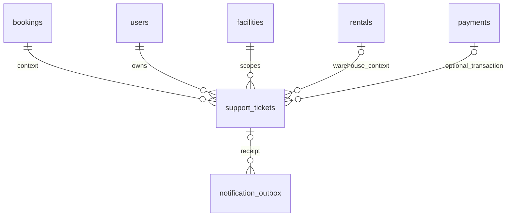

# metastorage database diagram

## System administrator and account lifecycle (#185, approved 2026-10-25)

`users` keeps its existing single role per account. Add partial unique index
users_single_system_admin_idx on role WHERE role = SYSTEM_ADMIN, allowing at most
one bootstrap SA. Management create/role APIs accept only CUSTOMER, FACILITY_STAFF,
FACILITY_MANAGER and BUSINESS_OPERATION_MANAGER. They cannot create/promote SA or
lock/demote the bootstrap SA. If legacy data has multiple SA rows, the unique-index
migration fails atomically for explicit resolution; never delete/disable users to
make it pass. Existing bootstrap/seed is retained.

Account role changes and locking serialize on the users row, then memberships.
Block changes while directly assigned booking is CONFIRMED, manual task is
ASSIGNED/IN_PROGRESS, support ticket is OPEN/IN_PROGRESS, or return
request is PENDING/CONFIRMED/INSPECTING/FAILED. Closed/completed historical work and
created_by/assigned_by audit references do not block changes. The existing handoff
flows remain authoritative; no automatic work transfer is introduced.

After handoff, user change, ending active facility assignments and deletion of all
Better Auth sessions commit together. Reactivation creates neither sessions nor
assignments. Changing assignment keeps sessions but membership guards read current
scope at the next request. SA/BOM keep assignment write permissions. Session
creation holds a user share lock and rechecks ACTIVE inside its insert transaction,
so a simultaneous lock/role change cannot leave a stale session behind.

## User history (#185, confirmed scope 2026-10-25)

`login_history` stores successful sign-ins only, across all roles: UUID id,
nullable user_id FK users (SET NULL), unique session_id (correlation identifier,
never a session token; no FK to transient sessions), occurred_at timestamptz,
nullable bounded device, operating_system, browser and model descriptions.
No failed sign-ins, logout, expiry, IP, credentials, tokens or raw request headers.
Device/model descriptions are best-effort client metadata, not proof of identity.
Indexes: (occurred_at,id), (user_id,occurred_at,id).

`user_activity_logs` records accepted mutation API requests across all roles,
excluding read/list/search/download operations: UUID id, nullable actor_id FK users
(SET NULL), bounded action/entity_type, nullable entity_id when no safe UUID is
available, nullable facility_id FK facilities (SET NULL), occurred_at timestamptz.
Accepted idempotent/no-op writes may appear; this is not an exact state-change ledger.
No arbitrary request payloads or financial/PII
snapshots. Indexes: (occurred_at,id), (actor_id,occurred_at,id),
(entity_type,entity_id,occurred_at,id), (facility_id,occurred_at,id).
Existing domain audits remain authoritative for their detailed before/after facts.

History starts at capture enablement; do not synthesize legacy records. Both logs
are best-effort per the user's 2026-10-25 decision: log failure never fails or rolls
back the main operation and emits an operational warning. SA-only read access
follows #185. Retention/cleanup remain TBD; no automatic cleanup is authorized.
User profile edits allow only own name/phone; administrators cannot edit another
user's profile.

## Facility-owned catalog and BOM ranges (approved 2026-10-24)

`rental_price_ranges`: UUID id, unique code, name, nullable integer-VND
min_monthly_price/max_monthly_price (both null for unconfigured/migrated ranges, or
0 < min <= max), is_active, nonnegative version, nullable updated_by FK users
(RESTRICT), created_at/updated_at. BOM alone creates/updates ranges. A range update
must reject any linked local price outside the proposed bounds; no guessed defaults.

`unit_types` belongs to exactly one facility through required facility_id FK
(RESTRICT) and one required price_range_id FK (RESTRICT). Code is unique per facility;
(facility_id,id) is also unique for composite references. Existing name/size_label,
positive dimensions, generated size_cbm, positive integer monthly_price and is_active remain local.
Add nonnegative version (default 0) and nullable updated_by FK users (RESTRICT).
Only the currently assigned active FM writes local types/prices. Dimension edits
are rejected once any booking references the type; create a
new type and move eligible free physical units instead. Price changes affect only
new quotes; booking and renewal snapshots are immutable. There is no unit_type_changes.
FM price writes and BOM range writes append the existing pricing_changes ledger;
the shared pricing revision remains serialized by the DEPOSIT_MONTHS settings row.

`facility_unit_types` is retired. storage_units/bookings/capacity_allocations
reference unit_types through (facility_id,unit_type_id),
preventing cross-facility types. Catalog, checkout and renewal lock the local type
in place of the retired offering. Range validation uses range-first/type-second
locks after the shared pricing revision; new quotes require configured active
bounds. Captures of existing quotes retain saved prices rather than recalculating.

The pre-production baseline creates facility-owned unit types directly from this
schema. Pre-baseline development databases are reset; the baseline does not migrate
their data.

## Rental renewals (#163, approved 2026-10-24)

`rental_renewals` retains immutable quote/acceptance facts: UUID id, rental_id FK,
nullable customer_id FK (SET NULL on account deletion), rental_version, unique
nullable charge_id/payment_id FKs, per-rental idempotency_key, status
(QUOTED/AWAITING_PAYMENT/APPLIED/EXPIRED/REFUND_REQUIRED), months 1..12,
old_end_at/new_end_at, positive integer-VND monthly_rate/amount, VND currency,
timezone/cutoff_at/expires_at, terms_version/terms, accepted_at/applied_at,
failure_reason and created_at. Amount equals months × snapshotted rate; each month
adds exactly 720 hours; expiry is at most 15 minutes after creation and no later
than the saved local cutoff. Acceptance creates one OPEN RENEWAL/RENEWAL_RENT
charge. Applied terms require an identified payment and application timestamp.
Partial unique (rental_id,rental_version) for APPLIED prevents duplicate extension.

`rentals.version` is nonnegative, starts at zero and increases once per applied
renewal. `expected_end_at` remains the current term; original booking end/pricing
is unchanged. `notification_outbox.rental_term_version` is nullable
for legacy events; expiry/overdue/review events identify the current term, and the
worker suppresses a queued event for an older version (legacy means version zero).
Facility → booking → rental locks serialize renewal with return/lifecycle;
the existing facility/type offering lock serializes capacity with checkout.
Quotes hold no capacity. Expired/conflicting captures create source-linked refunds
instead of extending or moving the physical unit. Unpaid RETURN_DEBT anywhere on
the customer's rentals blocks renewal; EXTRA is a separate obligation.
No unused rent refund for early return, including initial and renewal terms.
Historical refunds/snapshots remain recorded; captured but unapplied renewal money
uses the controlled charge-refund workflow.
OVERDUE begins at the saved expiry instant for an unreturned rental. Return-fee
assessment still compares local calendar dates; abandoned review keeps the existing
seven-full-local-day boundary starting at midnight on the following date.

## Facility work tasks

`facility_tasks` is one staff work queue for check-in and handover, unit inspection,
and support handling. `type` is `CHECK_IN_HANDOVER`, `UNIT_INSPECTION`, or
`HANDLE_SUPPORT`; `status` is `ASSIGNED`, `IN_PROGRESS`, `COMPLETED`, or
`CANCELLED`. Each row has UUID id, facility_id, reference_type/reference_id,
assigned_staff_id and assigned_by FKs, nullable description, nullable started_at
and completed_at, assigned_at, created_at and updated_at. The polymorphic reference
types are `BOOKING`, `STORAGE_UNIT`, and `SUPPORT_TICKET`; because one UUID column
cannot have foreign keys to three tables, repositories validate target existence
and same-facility scope under transaction locks.

`CHECK_IN_HANDOVER` always references a booking and is created or reassigned in the
same transaction as FM booking staff assignment. `UNIT_INSPECTION` references a
booking or storage unit; `HANDLE_SUPPORT` references a support ticket. Reassignment
resets an in-progress task to `ASSIGNED`; same assignee retries are no-ops. The
assigned active Facility Staff starts and completes the task. An assigned-facility
FM may cancel unfinished work. There is no separate task report, approval state,
title, or completion actor field; the existing inspection and support records own
their domain details.

Facility staff membership cannot be revoked while an assigned task is
`ASSIGNED` or `IN_PROGRESS`; booking and return workflows retain their own
assignment constraints.

## Return workflow consolidation

The return-specific tables and return audit table are removed. `rentals` is the
aggregate for one return lifecycle per rental. It stores the optional return slot,
local date, UTC start/end, timezone, return status as a PostgreSQL enum, reason and
manual-review flag. Its
partial unique facility/date/slot index preserves capacity one for CONFIRMED,
INSPECTING and FAILED returns. Staff assignment stays on the facility task.

The latest approved settlement snapshot is stored as JSONB on `rentals`, alongside
its approving user, time and reason. This keeps the current financial result but no
longer keeps earlier settlement revisions. Schedule edits update the rental directly;
there is no separate request/approval history for time changes. The return checklist
snapshot and results live in the CHECK_OUT row in `inspections.checklist`.

`payments.type`, `payments.status` and `payments.refund_reason` use PostgreSQL enums.
Type distinguishes COLLECTION from RETURN_REFUND. A return-refund row
links to the rental and original payment, stores amount/allocation, idempotency
key, transfer reference and confirmer/time in payment columns. Evidence
is stored in `media_assets`. Rental-charge adjustments/refunds no longer reference a
settlement row; their rental context is derived through the charge.

`system_settings` keys OPENING_HOUR/CLOSING_HOUR remain the shared operating window;
holiday calendars are out of scope. OVERDUE_FEE_RATE remains an integer rate 0–100
(seed 25), BOM-managed and audited. Missing policy blocks financial assessment.

Flow 4 pricing: `system_settings` key DEPOSIT_MONTHS stores positive integer value
and shared positive pricing version, nullable updated_by FK users and updated_at. The one-month starting policy is explicitly seeded, never a runtime
fallback. Missing policy prevents new quotes. `unit_types.monthly_price` remains
the current local price per facility-owned type. Updating a price, range or deposit locks
the settings row first, validates the relevant expectedVersion, increments the shared version
and appends `pricing_changes` in the same transaction. Existing booking monetary
snapshots are never recalculated. Drafts created before a change keep their
snapshot, including when they start payment after the change.

`pricing_changes`: UUID `id`, unique positive integer `version`, enum `operation`
(`DEPOSIT_POLICY`, `UNIT_TYPE_PRICE`, `RENTAL_PRICE_RANGE`), required JSONB `before`/`after` storing the
specific changed values, required `changed_by` FK users (RESTRICT), and timestamp
`changed_at`. No API modifies or deletes audit records. Settings are not exposed
to public/FS/FM/SA callers; configuration endpoints require BOM.

The existing-model sections record tables and columns declared in
`packages/database/src/schema`; separately labeled approved-design sections describe
future implementation, including Customer Support (#164). Flow 2 activates rentals at Staff handover; customer access requires an account;
Booking and Payment are introduced by issue #18.

Issue #24's handover inspection data now resides in the shared `inspections` table,
with evidence metadata in `media_assets`:

- Inspection type, status and condition use PostgreSQL enums declared with Drizzle
  `pgEnum`; exported constants and TypeScript types remain available to application code.
  Structural workflow checks remain database constraints.
- `media_assets.cloudinary_resource_type` also uses a PostgreSQL enum. Its generic
  `owner_type` and `purpose` remain varchar so additional modules can use shared media.

- CHECK_IN inspections link to the booking and physical unit. The exact verification
  and assignment linkage is validated by application logic, not stored as inspection FKs.
- New CHECK_IN inspections use checklist version `H6_4PASS_V1`: PENDING/IN_PROGRESS
  accepts incomplete results; PASSED requires PASS for ASSIGNED_UNIT, DOOR_LOCK,
  UNIT_CONDITION and EXISTING_INVENTORY. Notes/photos/signature are optional. Results
  and the immutable definition snapshot are stored in checklist JSONB. No inferred PASS
  or backfill. Saving explicit results on an old draft adopts the new policy; completed history stays unchanged.
- FM assignment atomically sets a free physical unit RESERVED. Other bookings cannot reserve
  that unit, even for non-overlapping dates. Reassign/cancel/no-show release RESERVED units only
  if no other live assignment or ACTIVE rental remains. Handover changes RESERVED to OCCUPIED.
- PASSED records inspect_done_at and freezes the baseline; it does not create a Rental,
  consume verification, mark CHECKED_IN or change the unit's occupancy (#25).
- Booking/inspection row locks reject conflicting writes. Only current
  verified assignments can be edited. Completed and superseded records remain readable by facility scope.
- Photos are private authenticated evidence, bounded to 8 JPEG/PNG/WebP files, 3 MiB each.
  Evidence is stored as authenticated Cloudinary assets, referenced by required public ID and
  format. PostgreSQL stores metadata only. Photo GET uses private/no-store caching.
- FM prepares unit/staff assignment and monitors records; only the assigned Facility Staff
  can verify, edit inspection evidence, complete inspection and confirm handover.
- A separate handover transaction creates exactly one ACTIVE rental
  per booking, marks booking CHECKED_IN, unit OCCUPIED (business In Use), and consumes verification.
  Rental dates use the registered booking period. No PIN/NFC or access-control requirement.
- Signature is optional and not a completion requirement. No automatic AI comparison or
  checkout/deposit charging is implemented by this issue.

```mermaid
erDiagram
  facility_tasks {
    uuid id PK
    uuid facility_id FK
    facility_task_type type
    facility_task_status status
    facility_task_reference_type reference_type
    uuid reference_id
    uuid assigned_staff_id FK
    uuid assigned_by FK
    integer version
    timestamptz started_at "nullable"
    timestamptz completed_at "nullable"
    timestamptz assigned_at
    timestamptz created_at
    timestamptz updated_at
  }
  facilities ||--o{ facility_tasks : scopes
  users ||--o{ facility_tasks : performs
  users ||--o{ facility_tasks : assigns
  facility_tasks }o--|| bookings : "reference when BOOKING"
  facility_tasks }o--|| storage_units : "reference when STORAGE_UNIT"
  facility_tasks }o--|| support_tickets : "reference when SUPPORT_TICKET"
  system_settings {
    text key PK
    jsonb value
    text description
    integer version
    uuid updated_by FK
    timestamptz updated_at
  }
  system_setting_changes {
    uuid id PK
    text key FK
    jsonb before
    jsonb after
    uuid actor_id FK
    text source
    timestamptz created_at
  }
  system_settings ||--o{ system_setting_changes : audits
  users ||--o{ system_setting_changes : changes
  pricing_changes {
    uuid id PK
    integer version UK
    pricing_change_operation operation
    jsonb before
    jsonb after
    uuid changed_by FK
    timestamptz changed_at
  }
  users o|--o{ system_settings : updates
  users ||--o{ pricing_changes : changes
  inspections {
    uuid id PK
    uuid storage_unit_id FK
    uuid rental_id FK "nullable"
    uuid booking_id FK "nullable"
    uuid inspected_by FK
    uuid task_id FK
    inspection_type inspection_type
    inspection_status status
    inspection_condition condition "nullable"
    jsonb checklist
    text notes "nullable"
    timestamptz inspected_at "nullable"
    timestamptz inspect_done_at "nullable"
  }
  media_assets {
    uuid id PK
    varchar owner_type
    uuid owner_id
    varchar purpose
    uuid uploaded_by FK
    varchar filename
    varchar mime_type
    integer byte_size
    cloudinary_resource_type cloudinary_resource_type
    text cloudinary_public_id
    varchar cloudinary_format
    timestamptz created_at
  }
  check_in_slots ||--o{ bookings : schedules
  users ||--o{ accounts : authenticates_with
  users ||--o{ sessions : signs_in_with
  users ||--o{ facility_assignments : receives
  facilities ||--o{ facility_assignments : has
  facilities ||--o{ unit_types : owns
  rental_price_ranges ||--o{ unit_types : constrains
  unit_types ||--o{ storage_units : materializes
  unit_types ||--o{ capacity_allocations : allocates
  unit_types ||--o{ bookings : books
  unit_types ||--o{ storage_units : materializes
  facilities ||--o{ storage_units : contains
  unit_types ||--o{ capacity_allocations : allocates
  facilities ||--o{ capacity_allocations : reserves
  users o|--o{ bookings : saves_history
  users o|--o{ bookings : assigned_to
  bookings ||--o| rentals : becomes
  facilities ||--o{ rentals : hosts
  storage_units ||--o{ rentals : occupies
  check_in_slots o|--o{ rentals : return_appointment
  users o|--o{ rentals : approves_return_settlement
  rentals ||--o{ rental_charges : owes
  rentals ||--o{ rental_renewals : renews
  rental_renewals o|--o| rental_charges : collects_rent
  payments o|--o| rental_renewals : applies
  users ||--o{ rental_charges : submits
  users o|--o{ rental_charges : approves
  rental_charges ||--o{ payments : attempts
  bookings ||--o{ payments : records
  rentals ||--o{ payments : return_refunds
  payments ||--o{ payments : refund_source
  users o|--o{ payments : confirms_manual_refund
  rental_charges ||--o{ rental_charge_adjustments : adjusts
  rental_charges ||--o{ rental_charge_events : audits
  rental_charges ||--o{ rental_charge_refunds : refunds
  payments ||--o{ rental_charge_refunds : refunds
  bookings ||--o{ checkin_verifications : verifies
  bookings o|--o{ inspections : checkin_context
  rentals o|--o{ inspections : checkout_context
  storage_units ||--o{ inspections : inspected
  facility_tasks ||--o{ inspections : assigned_work
  users ||--o{ inspections : inspects
  users ||--o{ media_assets : uploads
  users ||--o{ checkin_verifications : performs
  facilities ||--o{ checkin_verifications : scopes
  unit_assignments ||--o{ checkin_verifications : snapshots

  check_in_slots {
    uuid id PK
    text name
    time start_time
    time end_time
  }

  users {
    uuid id PK
    text name
    varchar email UK
    boolean email_verified
    text image
    varchar phone UK
    role role
    status status
    timestamptz created_at
    timestamptz updated_at
  }

  accounts {
    text id PK
    uuid user_id FK
    text account_id
    text provider_id
    text access_token
    text refresh_token
    text id_token
    timestamptz access_token_expires_at
    timestamptz refresh_token_expires_at
    text scope
    text password
    timestamptz created_at
    timestamptz updated_at
  }

  sessions {
    text id PK
    uuid user_id FK
    text token UK
    timestamptz expires_at
    text ip_address
    text user_agent
    timestamptz created_at
    timestamptz updated_at
  }

  verifications {
    text id PK
    text identifier
    text value
    timestamptz expires_at
    timestamptz created_at
    timestamptz updated_at
  }

  facility_assignments {
    uuid id PK
    uuid user_id FK
    uuid facility_id FK
    timestamptz assigned_at
    timestamptz ended_at
    boolean is_active
    role role
  }

  facilities {
    uuid id PK
    varchar code UK
    varchar name
    text address
    text description
    boolean is_active
    timestamptz created_at
    timestamptz updated_at
  }

  rental_price_ranges {
    uuid id PK
    varchar code UK
    varchar name
    integer min_monthly_price "nullable paired bounds"
    integer max_monthly_price "nullable paired bounds"
    boolean is_active
    integer version
    uuid updated_by FK "nullable"
    timestamptz created_at
    timestamptz updated_at
  }

  unit_types {
    uuid id PK
    uuid facility_id FK
    uuid price_range_id FK
    varchar code "unique within facility"
    varchar name
    varchar size_label
    numeric length_m
    numeric width_m
    numeric height_m
    numeric size_cbm "generated"
    integer monthly_price
    boolean is_active
    integer version
    uuid updated_by FK "nullable"
    timestamptz created_at
    timestamptz updated_at
  }

  storage_units {
    uuid id PK
    uuid facility_id FK
    uuid unit_type_id FK
    varchar code UK
    varchar floor "nullable"
    varchar location_description "nullable"
    storage_unit_status status
    timestamptz created_at
    timestamptz updated_at
  }

  capacity_allocations {
    uuid id PK
    uuid facility_id FK
    uuid unit_type_id FK
    uuid reference_id
    capacity_allocation_kind kind
    capacity_allocation_status status
    timestamptz starts_at
    timestamptz ends_at
    timestamptz created_at
    timestamptz updated_at
  }

  bookings {
    uuid id PK
    varchar booking_code UK
    uuid user_id FK "required; ON DELETE RESTRICT"
    varchar contact_phone "nullable before payment; booking-specific"
    uuid facility_id FK
    uuid unit_type_id FK
    integer requested_months
    date check_in_date
    uuid check_in_slot_id FK
    timestamptz rental_end_at
    numeric monthly_rate_snapshot
    numeric rental_fee_amount
    numeric deposit_amount
    numeric total_amount
    varchar status "default DRAFT"
    uuid assigned_staff_id FK "nullable"
    varchar qr_token_hash UK
    timestamptz created_at
    timestamptz updated_at
  }

  rentals {
    uuid id PK
    uuid booking_id FK,UK
    uuid facility_id FK
    uuid physical_unit_id FK
    rental_status status
    timestamptz start_at
    timestamptz expected_end_at
    integer version "nonnegative current term"
    timestamptz actual_return_at "nullable"
    timestamptz closed_at "nullable"
    uuid return_slot_id FK "nullable"
    date return_date "nullable"
    timestamptz return_starts_at "nullable"
    timestamptz return_ends_at "nullable"
    text return_timezone "nullable"
    rental_return_status return_status "nullable"
    text return_reason "nullable"
    boolean return_manual_review_required
    jsonb return_settlement "nullable latest snapshot"
    uuid return_settlement_approved_by FK "nullable"
    timestamptz return_settlement_approved_at "nullable"
    text return_settlement_reason "nullable"
    numeric deposit_amount
    timestamptz created_at
    timestamptz updated_at
  }

  rental_charges {
    uuid id PK
    uuid rental_id FK
    rental_charge_source source
    rental_charge_category category
    numeric amount "integer VND"
    varchar currency "VND"
    text evidence
    date due_date "nullable for return debt; extra charges require a due date"
    rental_charge_status status
    uuid created_by FK
    uuid approved_by FK "nullable"
    text decision_reason "nullable"
    timestamptz disputed_at "nullable"
    timestamptz created_at
    timestamptz updated_at
  }

  rental_renewals {
    uuid id PK
    uuid rental_id FK
    uuid customer_id FK "nullable on account deletion"
    integer rental_version
    uuid charge_id FK,UK "nullable until acceptance"
    uuid payment_id FK,UK "nullable until capture"
    varchar idempotency_key "unique per rental"
    renewal_status status
    integer months "1..12, 30 days each"
    timestamptz old_end_at
    timestamptz new_end_at
    numeric monthly_rate "integer VND"
    numeric amount "rate * months"
    varchar currency "VND"
    text timezone
    timestamptz cutoff_at
    timestamptz expires_at
    varchar terms_version
    text terms
    timestamptz accepted_at "nullable"
    timestamptz applied_at "nullable"
    text failure_reason "nullable"
    timestamptz created_at
  }

  rental_charge_adjustments {
    uuid id PK
    uuid charge_id FK
    rental_charge_adjustment_direction direction
    numeric amount "positive integer VND"
    text reason
    uuid created_by FK
    timestamptz created_at
  }

  rental_charge_events {
    uuid id PK
    uuid charge_id FK
    rental_charge_event_type type
    uuid actor_id FK "nullable for provider/system events"
    text reason "nullable"
    jsonb details
    timestamptz created_at
  }

  rental_charge_refunds {
    uuid id PK
    uuid charge_id FK
    uuid payment_id FK
    numeric amount "positive integer VND"
    text reason
    rental_charge_refund_status status
    text reference "nullable until confirmed"
    uuid confirmed_by FK "nullable"
    timestamptz confirmed_at "nullable"
    timestamptz created_at
  }

  payments {
    uuid id PK
    payment_type type
    uuid booking_id FK "nullable for rental-charge payments"
    uuid rental_charge_id FK "nullable; source-specific charge attempt"
    uuid rental_id FK "nullable return refund"
    uuid source_payment_id FK "nullable original payment for return refund"
    numeric deposit_refund_amount "nullable"
    numeric rent_refund_amount "nullable"
    varchar provider "nullable for manual refund"
    varchar provider_payment_id "nullable"
    varchar payment_code UK "nullable"
    varchar hold_token_hash "nullable for charge payment"
    varchar idempotency_key UK
    numeric total_amount
    varchar currency
    payment_status status
    timestamptz paid_at
    timestamptz expires_at "nullable payment quote expiry"
    payment_refund_reason_code refund_reason "nullable"
    numeric refund_amount "nullable; legacy refund falls back to total_amount"
    numeric deposit_forfeited_amount "NOT NULL DEFAULT 0"
    varchar refund_reference "nullable; bank transfer reference/evidence"
    timestamptz refunded_at "nullable"
    uuid refunded_by FK "nullable; ON DELETE RESTRICT"
    timestamptz created_at
    timestamptz updated_at
  }

  payment_provider_events {
    uuid id PK
    varchar provider
    varchar provider_event_id
    uuid payment_id FK
    varchar payment_code
    numeric amount
    varchar transfer_type
    varchar reference_code
    payment_provider_event_status status
    jsonb payload_metadata
    timestamptz created_at
    timestamptz updated_at
  }

  unit_assignments {
    uuid id PK
    uuid booking_id FK
    uuid physical_unit_id FK
    uuid assigned_by FK
    varchar status
    timestamptz assigned_at
    timestamptz ended_at
    text reason
  }

  checkin_verifications {
    uuid id PK
    uuid booking_id FK
    uuid facility_id FK
    uuid staff_id FK
    uuid unit_assignment_id FK
    checkin_verification_status status
    timestamptz verified_at
    timestamptz consumed_at
    timestamptz invalidated_at
    text invalidated_reason
    timestamptz created_at
    timestamptz updated_at
  }
```

## Existing constraints and behavior

- Booking confirmation emails have an intent/snapshot in the existing durable outbox,
  inserted in the payment transaction. The worker prepares an authenticated account
  booking URL and encrypted payload, then bridges to the existing BullMQ job/delivery ID.
  Legacy jobs remain readable; ENQUEUED differs from provider-confirmed SENT.

- UUID primary keys on `users`, `facilities`, `facility_assignments`,
  `facility_tasks`,
  `unit_types`, `storage_units`, `check_in_slots`,
  and `capacity_allocations` default to generated random UUIDs. Auth tables
  `accounts`, `sessions` and `verifications` use text primary keys.
- `users.email`, `users.phone`, `facilities.code`, `storage_units.code` and
  `sessions.token` are unique. `users.phone` is nullable. Booking contact email is not unique.
- Varchar limits are `users.email` 255, `users.phone` 20, Booking contact phone 32,
  `facilities.code` 50 and `facilities.name` 150;
  `unit_types.code` 80, `unit_types.name` 100, `unit_types.size_label` 50;
  `storage_units.code` 80.
- Nullable columns are `users.image`, `users.phone`,
  `users.role`, `users.status`, `facilities.description`,
  `facility_assignments.ended_at`, `storage_units.floor`,
  `storage_units.location_description`,
  `facility_tasks.started_at`, `facility_tasks.completed_at`,
  `rentals.actual_return_at`, `rentals.closed_at` and the optional return schedule,
  settlement snapshot and settlement approval fields; `payments.booking_id`,
  `rental_charge_id`, `rental_id`, `source_payment_id`, refund allocations,
  provider checkout fields, `hold_token_hash`, `paid_at`, `expires_at`, and refund
  metadata;
  `sessions.ip_address`,
  `sessions.user_agent`, and the optional token, expiry, scope and password
  fields in `accounts`. Other nullability follows the Drizzle schema.
- User role/status values are defined once in `packages/contracts/src/users.ts` and
  reused by Drizzle and API contracts. Changing those values still requires a database migration.
- Enum values are `role`: `CUSTOMER`, `FACILITY_STAFF`, `FACILITY_MANAGER`,
  `BUSINESS_OPERATION_MANAGER`, `SYSTEM_ADMIN`; `status`: `ACTIVE`, `INACTIVE`;
  `storage_unit_status`: `AVAILABLE`, `RESERVED`, `OCCUPIED`, `MAINTENANCE`,
  `INSPECTION`, `RETURN_PENDING`, `LOCKED`, `INACTIVE`;
  `facility_task_type`: `CHECK_IN_HANDOVER`, `UNIT_INSPECTION`, `HANDLE_SUPPORT`;
  `facility_task_status`: `ASSIGNED`, `IN_PROGRESS`, `COMPLETED`, `CANCELLED`;
  `facility_task_reference_type`: `BOOKING`, `STORAGE_UNIT`, `SUPPORT_TICKET`;
  `capacity_allocation_kind`: `HOLD`, `BOOKING`; and
  `capacity_allocation_status`: `ACTIVE`, `RELEASED`, `EXPIRED`;
  `inspection_type`: `CHECK_IN`, `CHECK_OUT`, `MAINTENANCE`;
  `inspection_status`: `PENDING`, `IN_PROGRESS`, `PASSED`, `FAILED`;
  `inspection_condition`: `GOOD`, `MINOR_DAMAGE`, `MAJOR_DAMAGE`;
  `cloudinary_resource_type`: `image`, `video`, `raw`;
  `payment_type`: `COLLECTION`, `RETURN_REFUND`;
  `payment_status`: `PENDING`, `SUCCEEDED`, `FAILED`, `REFUND_PENDING`, `REFUNDED`;
  `payment_refund_reason_code`: `NO_CAPACITY`, `CHECK_IN_CLOSED`,
  `OFFERING_UNAVAILABLE`, `CUSTOMER_CANCELLATION`, `NO_SHOW`;
  `rental_status`: `ACTIVE`, `RETURN_PENDING`, `OVERDUE`, `CLOSED`;
  `rental_return_status`: `PENDING`, `CONFIRMED`, `INSPECTING`, `FAILED`,
  `COMPLETED`, `CANCELLED`.
- Composite unique `accounts(provider_id, account_id)` ensures one owner per provider
  identity, including concurrent OAuth linking. Existing duplicates must be resolved
  explicitly before applying this constraint; never merge users automatically.
- Composite unique indexes exist on `facility_assignments(user_id, facility_id)`.
- Each User may work at at most one Facility at a time. A partial unique index
  `facility_assignments_active_user_idx` on `user_id WHERE is_active = true`
  enforces this rule, including concurrent assignments. Inactive assignments are
  retained. End or revoke the current assignment before assigning another Facility;
  elapsed `ended_at` rows must be deactivated before reassigning. The API does not
  automatically revoke a still-effective assignment to another Facility.
- Login through the shared API client and `GET /api/auth/me` include
  `user.assignedFacilityId`: the current assignment's Facility ID or `null`.
  Only assignments matching the User's Facility Staff/Manager role, with
  `is_active = true` and no elapsed `ended_at`, qualify. This field is derived,
  not a new column on User or Session, and does not replace backend scope checks.
- Before applying the single-Facility index migration, check for Users with
  multiple `is_active = true` assignments. Resolve them explicitly before
  migrating; the migration must not choose a Facility or discard history.
- `unit_types.code` is unique within a facility; `(facility_id,id)` is unique.
- `storage_units`, `bookings` and `capacity_allocations`
  each use a composite foreign key `(facility_id,unit_type_id)` to
  `unit_types(facility_id,id)` with ON DELETE RESTRICT. Range and facility ownership
  references also use RESTRICT. `capacity_allocations.reference_id` remains a UUID
  reference value without a database foreign key.
- User foreign keys use `ON DELETE CASCADE` for `accounts`, `sessions` and
  `facility_assignments`, and `ON DELETE RESTRICT` for `bookings.user_id`.
  Facility task references use `ON DELETE RESTRICT` to preserve assigned work.
  Facility foreign keys use `ON DELETE CASCADE` for
  `storage_units` and `facility_assignments`, and
  `ON DELETE RESTRICT` for capacity allocations.
- `created_at` and `updated_at` columns default to `now()` wherever shown;
  `assigned_at` also defaults to `now()`. `facilities.is_active`,
  `unit_types.is_active`, `rental_price_ranges.is_active` and
  `facility_assignments.is_active` default to true.
  `storage_units.status` defaults to `AVAILABLE`,
  `capacity_allocations.status` to `ACTIVE`. The default operating timezone is
  `Asia/Ho_Chi_Minh`. Operating hours are now global system settings, not a table.

Unit types belong to a facility and own their dimensions and monthly price within a
BOM-managed rental price range. Exact length, width and height are positive meters;
`size_cbm` is generated as their product, and floor area is calculated when reading.
Physical units inherit the dimensions of their local type. Availability and capacity
are scoped to `(facility_id,unit_type_id)`. Public catalog requires an active facility,
active type and active configured range containing its price.
Customers select a type; operations assign the physical unit later.

## Account-required booking (approved 2026-10-25; supersedes guest decisions)

Only active authenticated CUSTOMER accounts can create booking drafts, start payments,
read payment status, cancel bookings, or access their rentals/documents and return details.
Ownership is bookings.user_id, required with ON DELETE RESTRICT. No email-based claim,
guest checkout token, magic link, guest cookie or guest actor grants business access.
Existing guest business records are deleted before imposing NOT NULL; account-owned
records remain. Name and email are read from users, not copied onto bookings.
Signup does not require phone. At payment, contactPhone can be supplied for this booking;
otherwise users.phone is used. A valid phone is required, stored on bookings only, and
never written back to users. ContactPhone may be NULL only while the booking is DRAFT.
Issued contracts retain their own immutable snapshots. Payments and rentals continue to
derive ownership through booking. Accounts with bookings cannot be physically deleted;
use the existing account lock/status workflow instead. Guest access endpoints are removed.
The legacy reservation-draft checkout and table are removed.

## Payment and Booking notes (#18)

- Booking drafts store immutable pricing columns: rental fee equals
  the monthly rate times the requested months; the deposit equals one month's
  rate; total equals rental fee plus deposit, in VND. Payments use this stored
  quote even if catalog prices change later. Legacy unpriced drafts must be recreated.

- Booking stores per-booking phone and pricing snapshots; name/email come from users.
- bookings.user_id is required, indexed and references users with ON DELETE RESTRICT.
  Payment and Rental have no customer_id columns.
- paidAt comes from the earliest non-null payments.paid_at with status SUCCEEDED,
  REFUND_PENDING or REFUNDED. Booking queries join slots and aggregate payments before joining,
  preventing duplicate booking rows. Other consumers retain their timestamp
  projection until their dedicated query refactors.
- Booking status defaults to DRAFT; a CHECK limits it to DRAFT, CONFIRMED,
  CANCELLED, NO_SHOW or CHECKED_IN. Pricing columns remain required.
- Bookings retain nullable unique booking_code/qr_token_hash, nullable
  assigned_staff_id and required user_id. Operational lists/details
  exclude DRAFT; drafts cannot be assigned a unit/staff or verified through QR.
- Payment stores the transaction total, currency, provider references, status
  and paid_at; the monthly rate, rental fee and deposit breakdown belong to
  Booking. Readers project booking contact and date/slot timestamps for the
  existing API contracts.
- Payment status values are PENDING, SUCCEEDED, FAILED, REFUND_PENDING and REFUNDED,
  defined in the payment contract and reused by Drizzle. A valid incoming payment
  that cannot receive capacity/check-in becomes REFUND_PENDING with paid_at and
  refund_reason, while its booking stays DRAFT and holds are released. The full
  payment total (rent plus deposit) must be refunded manually. Only an admin or
  business operations manager may record REFUND_PENDING -> REFUNDED with a
  nonblank transfer reference, server timestamp and actor. Replays with the same
  reference preserve the original audit; a different reference conflicts.
- Customer cancellation and NO_SHOW retain the original payment total and snapshot
  `refund_amount = bookings.rental_fee_amount` and
  `deposit_forfeited_amount = bookings.deposit_amount`. Refund reasons distinguish
  CUSTOMER_CANCELLATION and NO_SHOW from full refunds for unfulfillable checkout.
  Refund amounts and forfeitures must be nonnegative, cannot individually exceed
  total_amount, and their sum cannot exceed total_amount. Existing pending/refunded
  rows with NULL refund_amount retain the previous full-total refund behavior.
  Manual refund readers/confirmation use the snapshotted refund amount.
- Payment provider integration is selected through a gateway adapter. The
  current implementation provides a mock/test adapter; the production provider
  pricing policy uses the confirmed one-month deposit rule for checkout.
- A successful payment changes the matching active capacity allocation from
  `HOLD` to `BOOKING` inside the same transaction. No physical unit is assigned
  at checkout.
- `payments.idempotency_key` and `(provider, provider_payment_id)` are unique.
- `payments.type = COLLECTION` references exactly one source: booking or rental charge.
  Booking attempts require a hold-token hash; charge attempts do not. `RETURN_REFUND`
  references a rental and its source payment without provider checkout fields. Partial
  unique indexes permit one pending attempt and one applied
  (`SUCCEEDED`) attempt per charge; late/duplicate provider captures remain
  separate refund-pending attempts. Charge payment quote expiry is stored separately from the
  charge due date; an expired quote can be retried with a new idempotency key.
- `rental_charges` stores source-specific obligations in integer VND. `EXTRA` is
  the charge itself; return-debt charges are associated through `rental_id`, without
  a settlement FK. Future renewal rows point to their charge in #163. No generic
  polymorphic source ID is used. Charge adjustments and refunds
  are append-only records; events retain submit/approve/dispute/payment/refund audit.
- The COLLECTION source CHECK requires exactly one of booking_id or rental_charge_id.
  Booking checkout uses booking_id plus a hold-token hash. Plaintext tokens are never stored.

Check-in slots are shared time-of-day definitions with exactly four required
columns: `id`, `name`, `start_time`, `end_time`. A Booking stores a required
`check_in_date` and `check_in_slot_id` instead of start/end timestamps. The
calendar date is interpreted in the facility timezone (currently Vietnam time).
Referenced slots cannot be deleted (`ON DELETE RESTRICT`). This change is
represented in the database by date and slot. Booking, payment, check-in and
rental readers project the start/end timestamps into existing API DTOs in
Asia/Ho_Chi_Minh time. Legacy draft requests map check_in_at to the containing
slot (start inclusive, end exclusive) and normalize draft/hold dates to that
slot's start before charging. A request outside the slots is rejected. Previously
created drafts with an unnormalized schedule must be recreated before payment.

Return closure marks the linked active unit assignment `COMPLETED` with `ended_at`,
and releases the linked active BOOKING capacity allocation in the same transaction.
`unit_assignments.status` is varchar; the shared status list now includes `COMPLETED`.
All nonclosed rental statuses (ACTIVE, RETURN_PENDING, OVERDUE) block reassignment/handover.

## Flow 3 review fixes — durable notifications and overdue review

- `rentals.abandoned_review_at`: nullable server timestamp, set once after seven
  full facility-local calendar days from the first overdue midnight while physical return remains unconfirmed.
  This flags FM manual review only; it grants no disposal or forfeiture authority.
- `notification_outbox`: one row per `(event_key, recipient_key)` with UUID id,
  booking/facility foreign keys, optional recipient user, snapshotted recipient email,
  event type, subject/text, occurred_at and in-app visibility. Customer email uses
  booking owner account; FM recipients are active facility assignments. No guest identity schema.
- Email delivery fields: PENDING/PROCESSING/SENT/REVIEW_REQUIRED, attempt count,
  next_attempt_at, first_attempt_at, lease token/expiry, provider message id and sent_at.
  Worker claims rows with row locks, sends outside the transaction, and conditionally
  acknowledges its lease. Retried sends retain one provider idempotency key and frozen
  content. Stop automatic retries after the provider's 24-hour idempotency window;
  retain REVIEW_REQUIRED for manual investigation. Do not promise exactly-once delivery.
- Outbox insert shares business transactions. Unique logical keys deduplicate callbacks,
  retries, concurrent cron runs and immediate/scheduled expiry reminders.
  In-app reads enforce current ownership or current FM facility assignment.
- Return inspection checklist and outcome are kept on the CHECK_OUT inspection row;
  this schema no longer stores a separate return-inspection attempt history.

## Flow 3 review corrections (2026-10-20)

Return refunds are payment rows with type RETURN_REFUND. Deposit/rent allocation fields
are nullable numeric(14,2); both are null or both are nonnegative and sum to the
refund amount. The refund row links to its rental and source payment and records the
manual transfer reference and confirmer. Earlier return-refund records and settlement
revisions are not retained by this simplified schema.

`notification_outbox.booking_email`: nullable JSONB snapshot (booking code, facility
name, unit type, verified paidAt, optional tracking-link delivery id/createdAt/expiry),
for customer BOOKING_CONFIRMED emails; legacy guest tracking-link deliveries are suppressed.
`mail_payload`: nullable encrypted existing mail-job payload; `mail_expires_at`: nullable
timestamp; `queued_at`: nullable timestamp. ENQUEUED means queued, not provider SENT.
No raw token in inbox or logs. The existing BullMQ queue/job ID/delivery ID and
24-hour TTL from link creation remain authoritative. Provider attempts record first_attempt_at
at send time, not enqueue time; ambiguous outcomes beyond 24h require review.
No historical booking email replay. Old queue jobs are adopted by the same job ID.

## Rental lifecycle configuration (2026-10-20)

`system_settings` includes `EXPIRY_REMINDER_DAYS` and `ABANDONED_REVIEW_DAYS`;
the legacy lifecycle API filters reads/writes to these two keys. Values are nonnegative PostgreSQL
integers; no business min/max is imposed. Seed values are 7 days for each setting.
System Administrator changes use optimistic version, store actor/time, and append
system_setting_changes in the same transaction. A sweep reads one settings snapshot for its
candidate query and state changes. Existing logical notification keys and review flags
remain stable after configuration changes.

Guest tracking, resend and return endpoints are removed. The obsolete booking_access_audit
table is dropped. Customer rental, payment, document and return operations require the
owning account session and use the existing customer endpoints.

## Unified system settings (2026-10-20; supersedes global settings tables above)

`system_settings` is the single active global configuration table: key PK, scalar JSONB
value, description, nonnegative version, updated_by FK users and updated_at. API keys
are an allowlist with per-key validation and permissions. Initial keys are
EXPIRY_REMINDER_DAYS (7), ABANDONED_REVIEW_DAYS (7), OVERDUE_FEE_RATE (25),
DEPOSIT_MONTHS (1), OPENING_HOUR (8) and CLOSING_HOUR (20). Day/hour settings use
bounded integers, rate 0–100 and months positive. DEPOSIT_MONTHS retains the positive shared pricing revision: price changes
also lock/increment this row. Existing quote/rental/settlement snapshots are unchanged.
System Admin manages rental-day settings; BOM manages financial settings and shared
operating hours. Return checklist versions, unit type prices and financial snapshots
remain relational domain data. Holiday calendars are out of scope.

`system_setting_changes`: UUID id, key FK, JSONB before/after value+version snapshots,
actor_id FK, source and created_at. Append-only changes share the update transaction;
existing pricing_changes remain the pricing history source.

The pre-production baseline creates the current settings schema directly. Existing
development databases must be reset before applying it; no legacy configuration
transfer is included.

## Customer Support request model (2026-10-27)

Support is a one-way customer request. Customers can discover their booking and
payment context, submit a subject and description, then view the immutable ticket.
There is no support chat, image upload, staff assignment, or ticket lifecycle.

### support_tickets

| Columns | Type and constraints |
| --- | --- |
| id | UUID primary key, server generated |
| booking_id, owner_user_id, facility_id | Required UUID foreign keys derived from the authenticated booking |
| rental_id | Nullable UUID FK; required for warehouse categories and must belong to the booking |
| payment_id | Nullable UUID FK; if present must belong to the booking |
| category | UNIT, LOCK, ACCESS_CODE, STORED_ITEMS, or PAYMENT |
| subject | Trimmed varchar(200), required |
| description | Trimmed text, 1–5000 characters |
| action_due_at | Required timestamp, created_at + 12 continuous hours |
| idempotency_key | Required key, unique with owner_user_id; request fields are compared on retry |
| created_at | Server-generated timestamp |

The initial request is the ticket itself. `notification_outbox` records the
creation receipt in the same transaction. Removed tables: `support_messages`,
`support_attachments`, `support_audit`, and `support_idempotency`.
Recheck current ownership/facility/assignee at read or sensitive delivery time.
Revoked FS can receive only a minimal revocation notice, without old ticket data.

### Lifecycle, workload and 12-hour tracking

Ticket lifecycle: OPEN → IN_PROGRESS → CLOSED. Assignment immediately enters
IN_PROGRESS; a separate FS start records first_onsite_started_at without another
ticket transition. FS report remains IN_PROGRESS until FM accepts/closes for
warehouse categories. BOM starts/resolves PAYMENT under its role.
Customer withdrawal closes with CUSTOMER_WITHDREW, stops Support work and never
marks an unfinished report/task successfully completed. Reopen is FM/BOM only
within category scope and requires a fresh assignment where needed.

12 continuous hours starts at created_at, without resetting on reassign.
Warehouse measurement distinguishes “FS assigned” and “FS arrived/started”;
assignment alone does not prove an onsite response. PAYMENT measures BOM's first
contact/start in 12 hours. Reopen preserves original timing/audit and does not
invent a fresh automatic SLA cycle or change the ticket's original created_at.
Priority HIGH is processed ahead of NORMAL; both retain the 12-hour maximum.
No new auto-dispatch, SLA engine, automatic escalation or realtime is approved.
There is no cross-role ESCALATE action in MVP; overdue work stays with the
authorized FM/BOM category owner and is visible in its manual queue.

Support ticket text remains on support_tickets; staff assignment is a linked
HANDLE_SUPPORT facility task. The task does not replace ticket content or alter
booking, inspection, occupancy, rental, payment, maintenance or access-code state.

## Facility workspace support events

The existing notification_outbox lifecycle enum additionally supports SUPPORT_UPDATED.
Support operation events use the existing support_ticket_id, versioned event key and
recipient uniqueness; IN_APP records are stored as SENT and are never mailed. Public
replies/resolutions enqueue customer email; private notes never enter customer or FS
notifications. Staff inbox visibility rechecks current ticket assignment and active
facility membership. No new ticket/message table is introduced.
